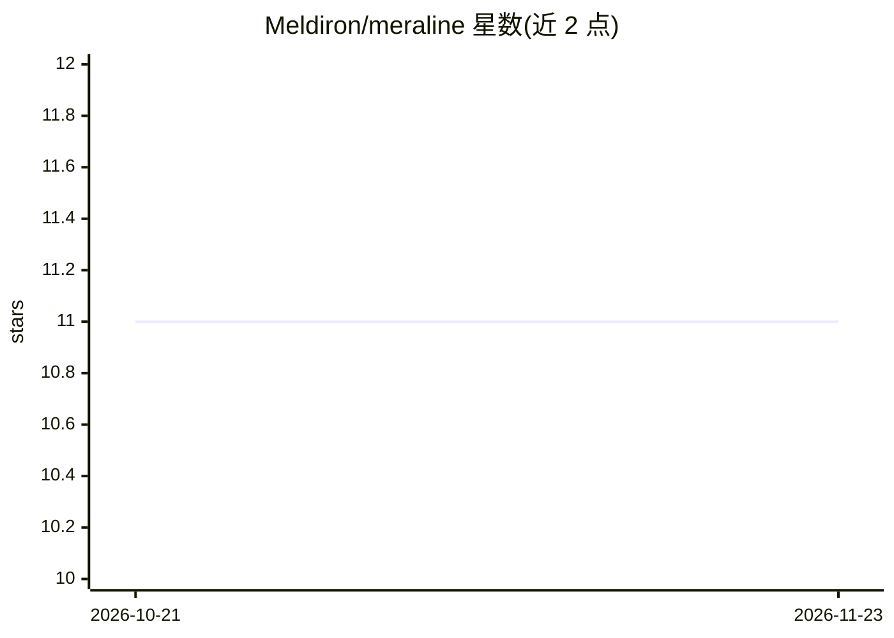

# Meldiron/meraline

⭐ 11 · Swift · MIT · 推送 2026-10-07 · [GitHub](https://github.com/Meldiron/meraline) · [官网](https://github.com/Meldiron/meraline/releases/latest) · 个人维护

**Mac 全局快捷键唤起的临时 AI 问答窗口**

Meraline 是一个 macOS 快捷问答回答应用：按 ⌥ Space 在任意应用上唤起小窗，输入问题后答案流式渲染（支持标题、表格、代码块）。核心机制是临时性——对话仅存内存，30 分钟后自动清除，不落盘。支持三种模式：LLM 问答、Agent（调用 Claude Code/Codex 等命令行代理及其 MCP 工具）、Decision（用 TypeSafe Jev 等决策模型做是/否或分级判断并给出置信度）。提供选中文本作上下文、图片/文件拖入、预设提示词、答案回贴原应用等功能。

## 筛选速览

| 维度 | 判定 | 备注 |
|---|---|---|
| AI 角色 | `ai-native` | 本体是模型或模型工具 |
| 许可风险 | `permissive` | MIT |
| 部署形态 | `desktop` | 安装包/桌面程序 |
| 模型依赖 | local-ok | 支持本地模型 |
| 硬件要求 | — | 无带数字的原话,不猜 |
| 安装摩擦 | `low` | 无编译、无系统依赖或容器化 |
| 成熟度 | — | 结构信号不足 |

## 能力要点

- ⌥ Space 全局唤起，对话仅存内存、30 分钟后清除
- 三种模式：LLM 问答、命令行 Agent（含 MCP 工具）、决策模型判定
- 接入 Apple Intelligence 本机模型，无需 key 或账号即可用
- 选中文本/文件作上下文，答案可原地改写并回贴原应用

## 适用场景

- 在任意应用中随选随问，总结或解释选中的文本
- 让 Agent 分析本地文件或项目副本并生成文件
- 用决策模型快速判断文本是否紧急、是否诈骗或分级
- 选中文本一键语法修正后粘贴回原处

## 场景标签

`AI 助手` `聊天机器人` · 领域:对话与助手

## 证据(README 行号)

> L15: Meraline is a tiny Mac app for quick questions. Press ⌥ Space , type, and the answer streams in a small glass windo
> L41: 🔌 **Uses the AI you already have.** The toggle under the input switches between asking an LLM, asking an agent, and
> L45: |**On this Mac**|Apple Intelligence, the on-device model in macOS 26|

## 星数曲线

2026-10-21 11 → 2026-11-23 11（+0）

---
*卡片 v1 · prompt 1.4 · 生成 2026-11-19 · 置信度 high · 依据 README sha `290d9665b686` · [字段定义](../../DATASET.md)*
