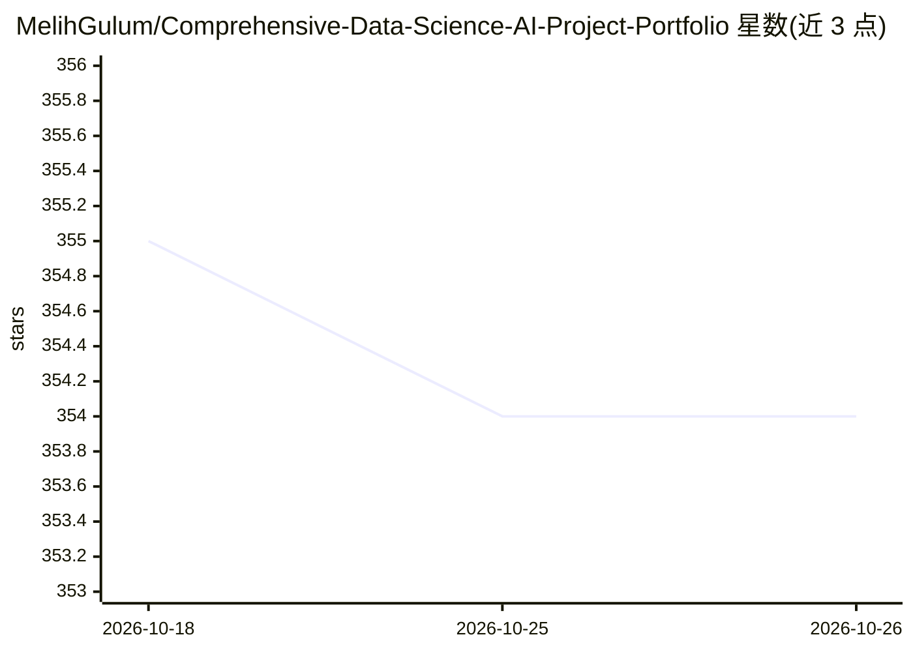

# MelihGulum/Comprehensive-Data-Science-AI-Project-Portfolio

⭐ 354 · Jupyter Notebook · 推送 2026-10-03 · [GitHub](https://github.com/MelihGulum/Comprehensive-Data-Science-AI-Project-Portfolio) · 个人维护

**个人数据科学与 AI 项目合集：ML/DL/数据工程/教程策展**

一个跨领域项目作品集仓库，收录机器学习（分类/回归/聚类/时序）、深度学习（计算机视觉/NLP/音频）、数据工程（ETL/Kafka 流水线）、数据分析（EDA/SQL）、AI 系统（RAG 检索）与云 DevOps 项目，另含 Pandas/NumPy/Docker/Kubernetes 等教程。每个项目文件夹含独立 README 说明环境搭建、方法与结果；工具栈涉及 Python、Scikit-Learn、TensorFlow、SQL、Kafka、Docker、Terraform、Flask、AWS/GCP。面向学习者与从业者，路线图列出待扩展方向。

## 筛选速览

| 维度 | 判定 | 备注 |
|---|---|---|
| AI 角色 | `ai-knowledge` | 知识聚合/清单类 |
| 许可风险 | `none` | — |
| 部署形态 | `None` |  |
| 模型依赖 | — | README 未给出锁定关系 |
| 硬件要求 | — | 无带数字的原话,不猜 |
| 安装摩擦 | `low` | 无编译、无系统依赖或容器化 |
| 成熟度 | — | 结构信号不足 |

## 能力要点

- 覆盖 ML/DL/数据工程/EDA/SQL/RAG/DevOps 七大类的项目目录
- 每个项目文件夹附独立 README（搭建说明、方法、结果）
- 含 Librosa/Pandas/NumPy/Docker/Kubernetes 等教程集合
- 工具栈含 TensorFlow、Kafka、Terraform、Flask、AWS/GCP

## 适用场景

- 系统浏览各领域数据科学项目案例与方法
- 查找特定任务（分类/回归/EDA/RAG）的参考实现
- 跟随教程学习 Python、SQL、Docker、Kubernetes 等技能

## 场景标签

`教程课程` · 领域:学习与行业

## 证据(README 行号)

> L3: A curated collection of projects across **Machine Learning**, **Deep Learning**, **Data Engineering**, **Data Analys
> L7: Each project folder contains a dedicated README with setup instructions, methodology, and results.

## 星数曲线

2026-10-18 355 → 2026-10-26 354（-1）

---
*卡片 v1 · prompt 1.4 · 生成 2026-10-21 · 置信度 high · 依据 README sha `c1f39ab62afb` · [字段定义](../../DATASET.md)*
