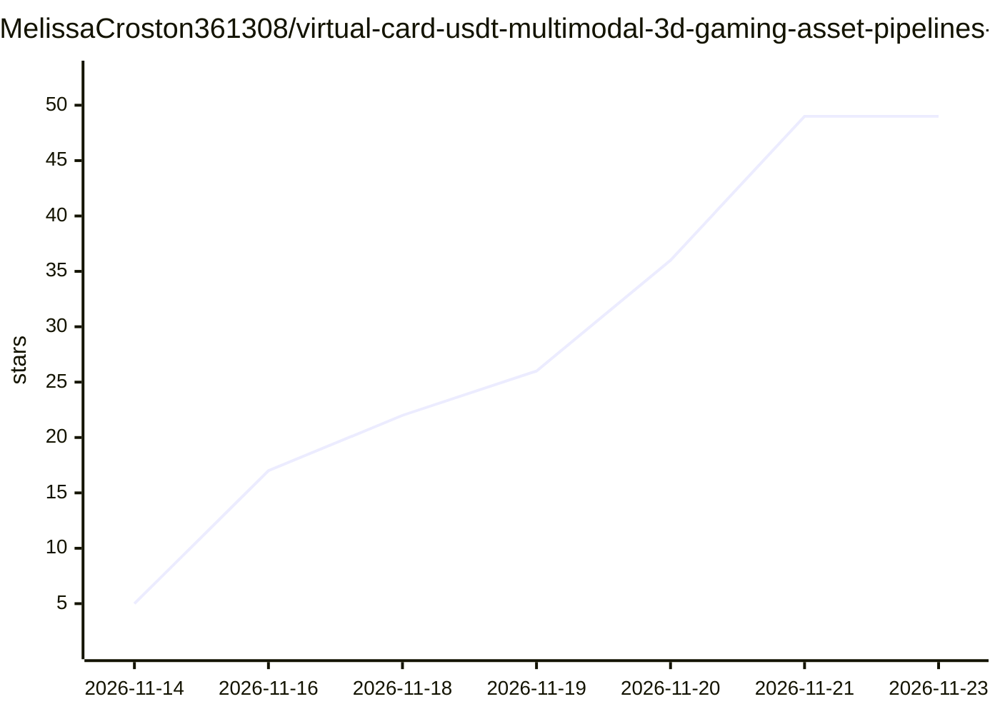

# MelissaCroston361308/virtual-card-usdt-multimodal-3d-gaming-asset-pipelines-vcc

⭐ 49 · 推送 2026-11-14 · [GitHub](https://github.com/MelissaCroston361308/virtual-card-usdt-multimodal-3d-gaming-asset-pipelines-vcc) · [官网](https://app.coregold.io/signup?invite_code=ADvlj9b) · 个人维护

**面向游戏工作室的 USDT 虚拟卡支付清结算指南（CoreGold VCC）**

一份架构式 FinOps 与支付清结算指南文档，面向使用 AI 生成 3D/游戏资产（如 Genie 4、Meshy、Tripo3D、ChatGPT）的独立工作室。内容说明高价订阅被拒付、多席位共用实体卡导致风控的问题，并给出方案：用 USDT 充值 CoreGold 平台发行美国商业虚拟卡，每席位一卡、设硬性消费上限，支持 Apple Pay 令牌化，里程碑结束后一键销卡回收余额。仓库本身是推广性文档，无可安装的软件。

## 筛选速览

| 维度 | 判定 | 备注 |
|---|---|---|
| AI 角色 | `ai-knowledge` | 知识聚合/清单类 |
| 许可风险 | `none` | — |
| 部署形态 | `None` |  |
| 模型依赖 | — | README 未给出锁定关系 |
| 硬件要求 | — | 无带数字的原话,不猜 |
| 安装摩擦 | `low` | 无编译、无系统依赖或容器化 |
| 成熟度 | — | 结构信号不足 |

## 能力要点

- USDT（TRC20/ERC20）充值并即时转换为美元余额的流程说明
- 按艺术家席位发行独立商业 BIN 虚拟卡并设硬性消费上限的方案
- Apple Pay DPAN 令牌化与北美 AVS 直付两条支付路径
- 里程碑结束后一键销卡、余额回笼主资金池的流程

## 适用场景

- 游戏工作室为多个 AI 工具席位配置相互隔离的支付方式
- 规避高价订阅的跨境拒付与共享卡片指纹风控问题
- 项目冲刺结束后清理订阅扣费并回收余额

## 场景标签

 · 领域:金融科技/支付方案

## 证据(README 行号)

> L2: An architectural FinOps and payment-clearing guide for AI-native 3D &amp; interactive game-asset pipelines (Google G
> L7: However, scaling commercial 3D and interactive asset generation across a distributed art team creates immediate bill
> L46: 1. **Inject Liquidity via USDT**: Register and log in to the CoreGold Console. Navigate to **Asset Management** and

## 星数曲线

2026-11-14 5 → 2026-11-23 49（+44）

---
*卡片 v1 · prompt 1.4 · 生成 2026-11-18 · 置信度 high · 依据 README sha `7b630a262c7c` · [字段定义](../../DATASET.md)*
