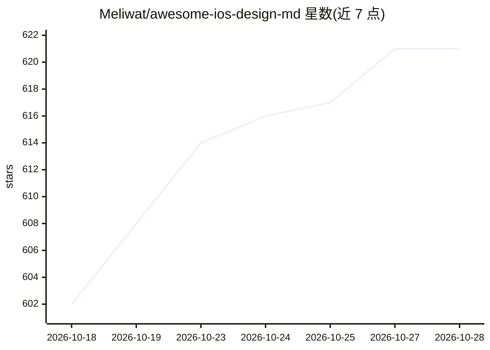

# Meliwat/awesome-ios-design-md

⭐ 627 · MIT · 推送 2026-05-21 · [GitHub](https://github.com/Meliwat/awesome-ios-design-md) · [官网](https://www.spectr.to/gallery) · 个人维护

**给 AI 编码代理的 200 个真实 App 设计系统文档库**

收录 200 款流行应用的逆向整理设计系统文档（DESIGN.md），以纯 Markdown 记录精确色值、字体层级、组件状态、动效曲线与触觉反馈，供 Claude、Cursor、Codex、Stitch 等 AI 编码代理直接读取以生成风格一致的 UI。每个应用提供框架中立、SwiftUI、Expo、Jetpack Compose 四种版本，按 11 个类别组织，另配在线画廊可免费浏览各应用渲染效果。使用方式为将文档放入项目根目录并在提示词中引用。

## 筛选速览

| 维度 | 判定 | 备注 |
|---|---|---|
| AI 角色 | `ai-knowledge` | 知识聚合/清单类 |
| 许可风险 | `permissive` | MIT |
| 部署形态 | `None` |  |
| 模型依赖 | — | README 未给出锁定关系 |
| 硬件要求 | — | 无带数字的原话,不猜 |
| 安装摩擦 | `low` | 无编译、无系统依赖或容器化 |
| 成熟度 | — | 结构信号不足 |

## 能力要点

- 200 个应用设计系统，每应用含四种框架版本（中立/SwiftUI/Expo/Compose）
- 记录精确 hex 色值、完整字阶、组件状态与动效曲线
- 纯 Markdown 格式，无需 Figma 导出、JSON 或额外工具
- 配套在线画廊免费预览每个应用的设计 token 渲染效果

## 适用场景

- 让 AI 编码代理按 Spotify、Instagram 等真实应用风格生成界面
- 为移动应用项目提供可复用的设计规范文档
- 在设计到代码工作流中替代手动整理设计 token

## 场景标签

`精选清单` · 领域:学习与行业

## 证据(README 行号)

> L15: Hand your AI coding agent a `DESIGN.md` and it stops guessing. Each file is a complete, reverse-engineered design s
> L35: DESIGN.md is a plain-text design system document that AI agents read to generate consistent UI. Just a markdown fil

## 星数曲线

2026-10-18 602 → 2026-10-28 621（+19）

---
*卡片 v1 · prompt 1.4 · 生成 2026-10-22 · 置信度 high · 依据 README sha `a1541ccb3927` · [字段定义](../../DATASET.md)*
