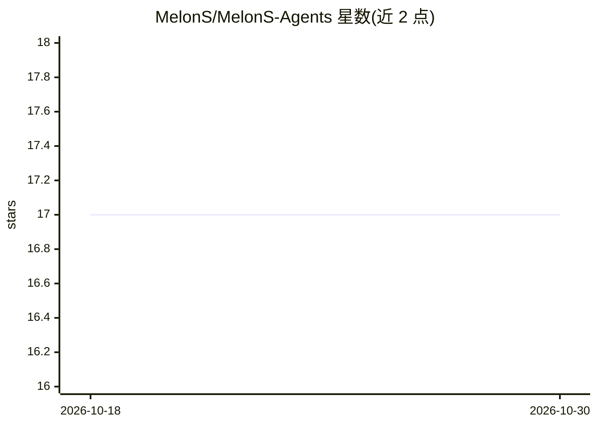

# MelonS/MelonS-Agents

⭐ 17 · C# · MIT · 推送 2026-08-22 · [GitHub](https://github.com/MelonS/MelonS-Agents) · [官网](https://melons.github.io/MelonS-Agents/) · 个人维护 · 中文 README

**多智能体系统：音乐生成短视频，并自建自验证殖民地模拟游戏**

个人用 Claude Code 构建的多智能体系统，包含多条流水线：music-video 把一首歌生成 60 秒 9:16 竖屏短片（节拍对齐剪辑）；content-shorts 生成经版权审查的短视频；game-dev-agent 构建并自我验证殖民地模拟游戏 PawnSim。运行时依赖本地开源工具（ffmpeg、whisper.cpp、ollama、aubio），Claude Code 智能体只做编排，宣称零运行时 API 费用。验证机制包括每次提交 22 场景输入级重现门禁与仅看截图/日志的隔离评审子智能体。Mac/Linux 可克隆运行，构建游戏需 Windows + Unity 6000.0.75f1。

## 筛选速览

| 维度 | 判定 | 备注 |
|---|---|---|
| AI 角色 | `ai-native` | 本体是模型或模型工具 |
| 许可风险 | `permissive` | MIT |
| 部署形态 | `desktop` | 安装包/桌面程序 |
| 模型依赖 | local-ok | 支持本地模型 |
| 硬件要求 | — | 无带数字的原话,不猜 |
| 安装摩擦 | `medium` | 含编译或系统依赖之一 |
| 成熟度 | `idea` | |

## 能力要点

- music-video 流水线：歌曲 → 60 秒 9:16 短片，节拍对齐剪辑
- PawnSim 由智能体构建并以 22 场景重现门禁 + 隔离评审子智能体验证
- 流水线以 LangGraph 状态机运行，在昂贵阶段前设门禁节省渲染时间
- 本地工具链（ffmpeg/whisper.cpp/ollama/aubio）承担机械工作，宣称零运行时 API token

## 适用场景

- 把一首歌自动生成 60 秒竖屏短视频
- 参考其智能体自验证游戏构建的门禁与评审机制
- 在本地零 API 成本运行媒体生成流水线

## 场景标签

 · 领域:AI 应用/自动化内容生产

## 证据(README 行号)

> L5: ### A multi-agent system built solo with Claude Code. It turns music into short-form video, and builds a colony-sim 
> L37: - **Zero runtime cost.** Local open-source tools (ffmpeg · whisper.cpp · ollama · aubio) do the mechanical work; Cl
> L69: |**music-video**|a song in → a 60-second 9:16 short (beat-aligned cuts, vintage ffmpeg shaders)|Production\*|✅ Mac/

## 星数曲线

2026-10-18 17 → 2026-10-30 17（+0）

---
*卡片 v1 · prompt 1.4 · 生成 2026-10-30 · 置信度 low · 依据 README sha `0dc1a6ceb85a` · [字段定义](../../DATASET.md)*
