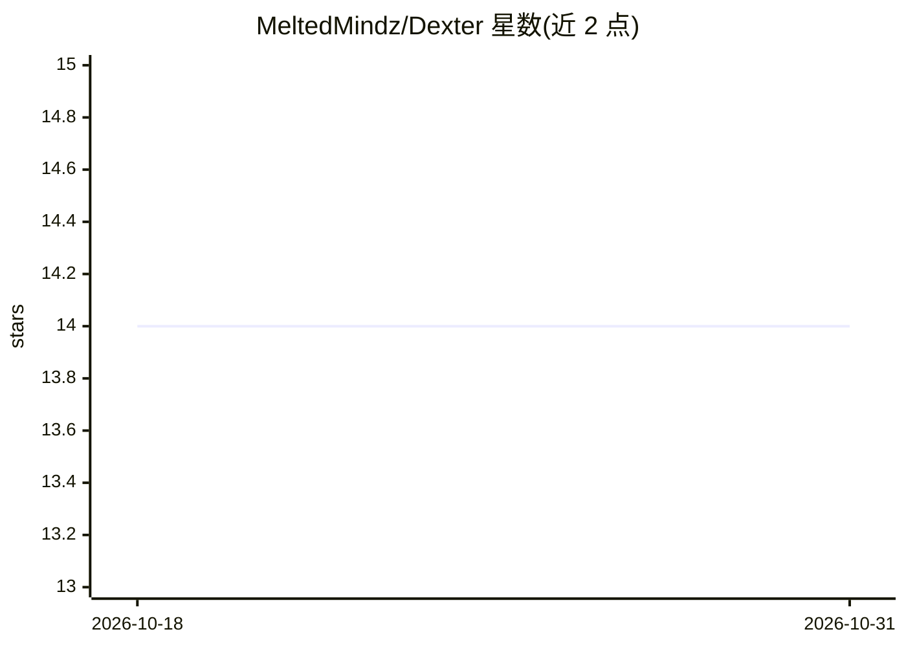

# MeltedMindz/Dexter

⭐ 14 · Python · NOASSERTION · 推送 2026-01-19 · [GitHub](https://github.com/MeltedMindz/Dexter) · [官网](https://www.dexteragent.com/) · 组织维护

**面向 Uniswap V3/V4 的 AI 流动性管理 DeFi 协议（开发中）**

DeFi 流动性管理框架，含 Solidity 智能合约（DexterMVP/BinRebalancer/UltraFrequentCompounder，通过 62 项测试）、TWAP 预言机与紧急暂停等安全机制、Flask 后端结构与 ML 管线设计（费用预测、区间优化、波动率预测等模型，目前使用模拟数据训练）。定位为对 Uniswap V3 头寸做自动复投与再平衡，采用 ERC4626 金库标准。README 自述处于 Development Phase，合约尚未部署到测试网/主网，ML 模型待真实数据验证，许可为 Source Available。

## 筛选速览

| 维度 | 判定 | 备注 |
|---|---|---|
| AI 角色 | `ai-enhanced` | 去掉 AI 部分产品仍成立 |
| 许可风险 | `none` | NOASSERTION |
| 部署形态 | `library` | 以包/库形式分发 |
| 模型依赖 | — | README 未给出锁定关系 |
| 硬件要求 | — | 无带数字的原话,不猜 |
| 安装摩擦 | `low` | 无编译、无系统依赖或容器化 |
| 成熟度 | `idea` | |

## 能力要点

- MVP 合约通过 62 项测试（42 单元 + 20 集成），含 TWAP 防护与紧急暂停
- 接受 Uniswap V3 头寸 NFT 存入，支持逐头寸自动复投/再平衡与批量操作
- ML 管线设计了费用预测、区间优化、波动率预测、收益优化四类模型
- ERC4626 金库标准与 Docker/Kafka/PostgreSQL/Redis 基础设施定义

## 适用场景

- 将 Uniswap V3 流动性头寸存入金库做自动复投与再平衡
- 通过 ML 模型辅助选择复投时机与参数（尚待验证）
- 机构级 DeFi 基础设施的原型参考

## 场景标签

 · 领域:DeFi/区块链金融

## 证据(README 行号)

> L5: > *Dexter Protocol is an ambitious DeFi infrastructure project with comprehensive AI/ML pipeline design and smart co
> L141: # Currently generates random data for development

## 星数曲线

2026-10-18 14 → 2026-10-31 14（+0）

---
*卡片 v1 · prompt 1.4 · 生成 2026-10-31 · 置信度 mid · 依据 README sha `46efc6202011` · [字段定义](../../DATASET.md)*
