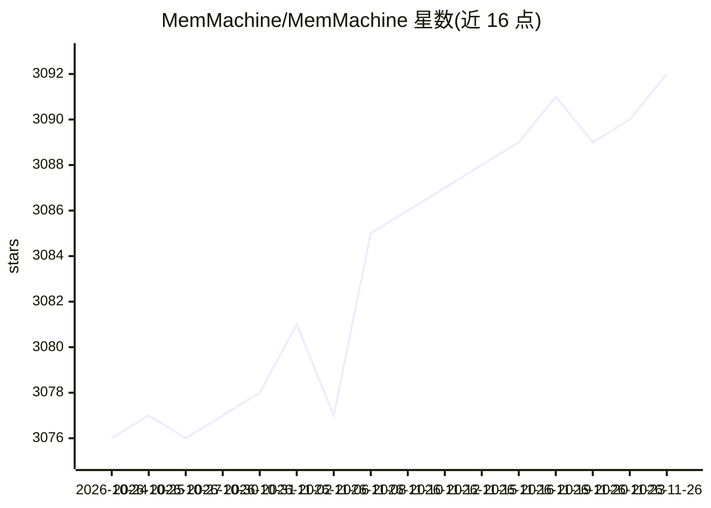

# MemMachine/MemMachine

⭐ 3,092 · Python · Apache-2.0 · 推送 2026-11-25 · [GitHub](https://github.com/MemMachine/MemMachine) · [官网](https://memmachine.ai) · 组织维护

**为 AI Agent 提供跨会话长期记忆存储与检索的层**

面向 AI Agent 与 LLM 应用的开源长期记忆层，提供三类记忆：基于图数据库的情景记忆（跨会话对话上下文）、SQL 存储的画像记忆（用户事实与偏好）、会话内工作记忆。通过 RESTful API、Python/TypeScript SDK 与 MCP 服务器接入，可自托管（本地/Docker/Neo4j+SQL）或使用其托管云服务，宣称与具体 LLM 无关。目标用户为构建 Agent 的开发者、研究者与团队。README 附带示例 Agent 与学术参考文献。

## 筛选速览

| 维度 | 判定 | 备注 |
|---|---|---|
| AI 角色 | `ai-ecosystem` | LLM/agent 周边工具 |
| 许可风险 | `permissive` | Apache-2.0 |
| 部署形态 | `self-host` | docker 或自建部署 |
| 模型依赖 | local-ok | 支持本地模型 |
| 硬件要求 | — | 无带数字的原话,不猜 |
| 安装摩擦 | `low` | 无编译、无系统依赖或容器化 |
| 成熟度 | — | 结构信号不足 |

## 能力要点

- 三类记忆：工作记忆、情景记忆（Neo4j 图库）、画像记忆（SQL）
- 提供 Python SDK、RESTful API、TypeScript SDK 与 MCP 服务器接口
- 支持与 LangChain、LangGraph、CrewAI、LlamaIndex 等框架集成
- 可自托管（本地/Docker）或使用托管云服务

## 适用场景

- 让客服/CRM Agent 记住客户历史与沟通进度
- 写作助手持续学习用户的风格与术语
- 为多轮对话机器人保存跨会话的用户偏好

## 场景标签

`Agent 记忆` · 领域:Agent 开发

## 证据(README 行号)

> L5: **The open-source memory layer for AI agents.**
> L22: MemMachine is an open-source **long-term memory layer** for AI agents and LLM-powered applications. It enables your
> L89: - **Developer-Friendly APIs**: Python SDK, RESTful API, TypeScript SDK, and MCP server interfaces

## 星数曲线

2026-10-24 3,076 → 2026-11-26 3,092（+16）

---
*卡片 v1 · prompt 1.4 · 生成 2026-11-26 · 置信度 mid · 依据 README sha `8c352ff06832` · [字段定义](../../DATASET.md)*
