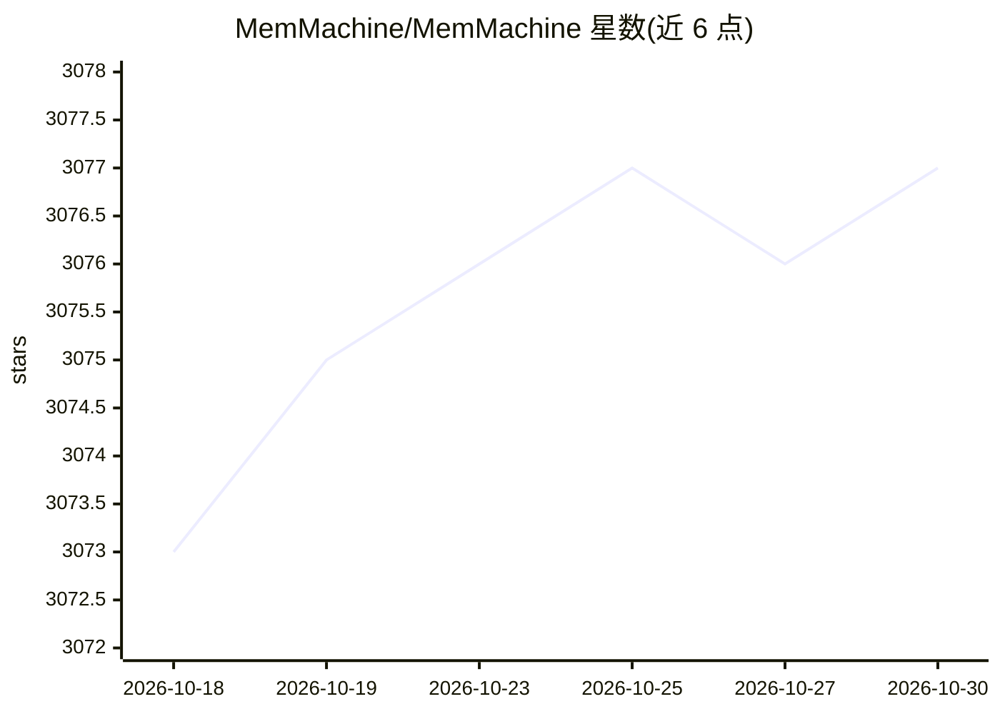

# MemMachine/MemMachine

⭐ 3,077 · Python · Apache-2.0 · 推送 2026-10-29 · [GitHub](https://github.com/MemMachine/MemMachine) · [官网](https://memmachine.ai) · 组织维护

**AI Agent 开源长期记忆层：跨会话存储与召回记忆**

为 AI agent 与 LLM 应用提供持久化记忆存储与检索的开源层：将交互存为情景记忆（图数据库 Neo4j）与画像记忆（SQL），另含会话内工作记忆，使无状态聊天机器人变为跨会话可记忆的助手。提供 Python/TypeScript SDK、REST API 与原生 MCP server，集成 LangChain、LangGraph、CrewAI、LlamaIndex 等框架。LLM 无关，兼容 OpenAI、Anthropic、Bedrock、Ollama 等。需运行 MemMachine Server，支持自托管、Docker 或托管云服务；采用 Apache 2.0 许可。

## 筛选速览

| 维度 | 判定 | 备注 |
|---|---|---|
| AI 角色 | `ai-ecosystem` | LLM/agent 周边工具 |
| 许可风险 | `permissive` | Apache-2.0 |
| 部署形态 | `self-host` | docker 或自建部署 |
| 模型依赖 | — | README 未给出锁定关系 |
| 硬件要求 | — | 无带数字的原话,不猜 |
| 安装摩擦 | `low` | 无编译、无系统依赖或容器化 |
| 成熟度 | — | 结构信号不足 |

## 能力要点

- 三种记忆类型：Working/Episodic/Profile，跨重启与模型更换持久化
- 原生 MCP server（stdio/HTTP 模式），接入 Claude Desktop、Cursor 等客户端
- Python SDK、TypeScript SDK、RESTful API 多种接口
- 与 LangChain、LangGraph、CrewAI、LlamaIndex、Dify 等框架集成

## 适用场景

- 为我的客服 agent 记住客户历史与交易阶段
- 让个人助手跨会话记住我的偏好与背景信息
- 为多 agent 系统提供共享的长期记忆后端
- 让写作助手学习我的风格指南与术语习惯

## 场景标签

`Agent 记忆` · 领域:Agent 开发

## 证据(README 行号)

> L22: MemMachine is an open-source **long-term memory layer** for AI agents and LLM-powered applications. It enables your
> L90: - **Developer-Friendly APIs**: Python SDK, RESTful API, TypeScript SDK, and MCP server interfaces

## 星数曲线

2026-10-18 3,073 → 2026-10-30 3,077（+4）

---
*卡片 v1 · prompt 1.4 · 生成 2026-10-20 · 置信度 high · 依据 README sha `fa2bfc44b892` · [字段定义](../../DATASET.md)*
