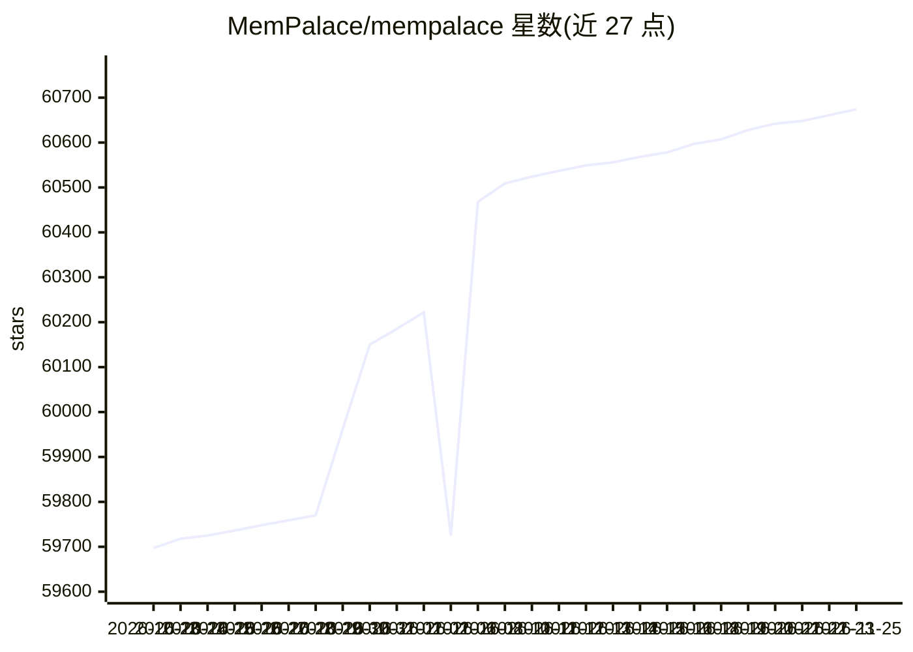

# MemPalace/mempalace

⭐ 60,674 · Python · MIT · 推送 2026-11-23 · [GitHub](https://github.com/MemPalace/mempalace) · [官网](http://mempalaceofficial.com/) · 组织维护

**本地优先的 AI 对话记忆存储与检索系统（MCP 服务器）**

以逐字文本存储对话历史并用语义检索取回的本地记忆库，不做摘要或改写；索引按 wing/room/drawer 层级结构化以便范围化搜索。检索后端可插拔，默认 ChromaDB，另有 sqlite_exact、rust_exact、milvus、qdrant、pgvector。默认路径零 API 调用、数据不出本机。通过 uv/pipx/pip 安装 CLI，提供 Docker 镜像（含 GPU 变体需自行构建），以 MCP stdio 服务器接入 Claude Code 等客户端，含 47 个 MCP 工具、知识图谱、自动保存 hooks 与基准测试复现脚本。

## 筛选速览

| 维度 | 判定 | 备注 |
|---|---|---|
| AI 角色 | `ai-ecosystem` | LLM/agent 周边工具 |
| 许可风险 | `permissive` | MIT |
| 部署形态 | `self-host` | docker 或自建部署 |
| 模型依赖 | — | README 未给出锁定关系 |
| 硬件要求 | — | 无带数字的原话,不猜 |
| 安装摩擦 | `low` | 无编译、无系统依赖或容器化 |
| 成熟度 | — | 结构信号不足 |

## 动量与使用信号

- 维护:`active` — 距上次 push 0.6 天,年发版 19,146 位贡献者
- 涨星:近 1 天 **+19**(自 20261016 起算)
- 安装:npm 包 `skills` 月下载 23,786,800
- 平台:LINUX / ANDROID · 协议:OPENAI-API / MCP / OLLAMA

## 能力要点

- 逐字存储+语义检索，raw 模式无 LLM、无 API key（LongMemEval R@5 96.6%）
- 可插拔检索后端：ChromaDB 默认，另支持 Milvus/Qdrant/pgvector/SQLite/Rust 原生引擎
- 47 个 MCP 工具与时间性知识图谱（本地 SQLite）
- 为 Claude Code、Codex CLI、Cursor IDE 提供自动保存 hooks

## 适用场景

- 给 Claude Code 等编码 agent 加上跨会话长期记忆
- 在本地离线环境存储并检索历史对话与项目文件
- 团队共享记忆的 hub/客户端部署

## 场景标签

`Agent 记忆` · 领域:Agent 开发

## 证据(README 行号)

> L22: MemPalace stores your conversation history as verbatim text and retrieves
> L264: 47 MCP tools cover palace reads/writes, knowledge-graph operations,
> L199: For Claude Code, Gemini CLI, Antigravity,

## 星数曲线

2026-10-23 59,697 → 2026-11-25 60,674（+977）

---
*卡片 v1 · prompt 1.4 · 生成 2026-11-22 · 置信度 high · 依据 README sha `a3a7e7e7727e` · [字段定义](../../DATASET.md)*
