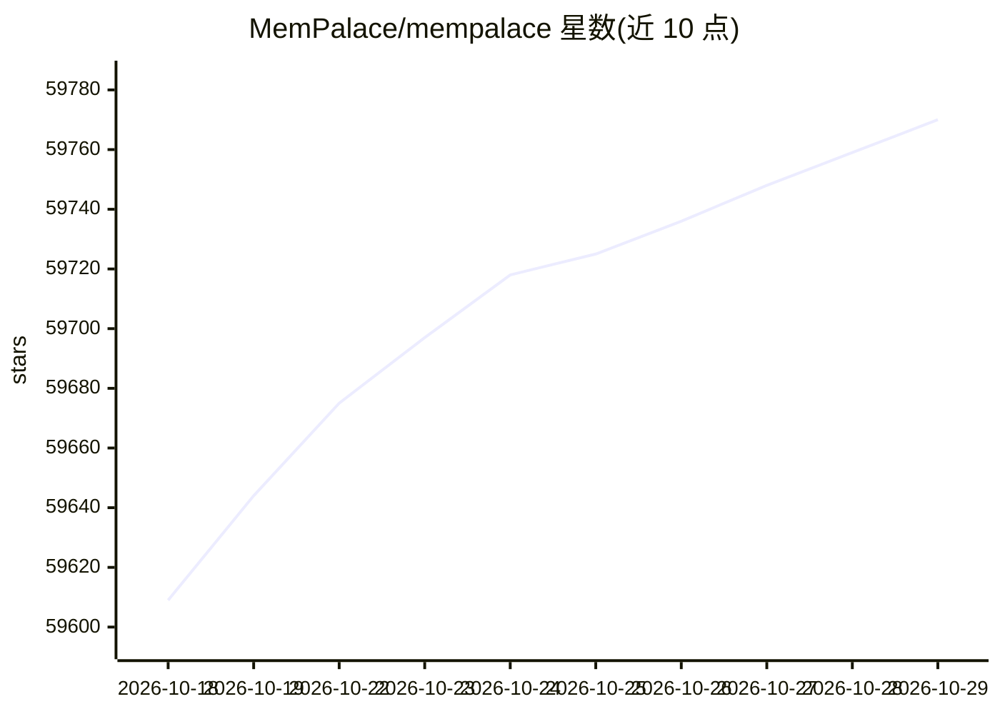

# MemPalace/mempalace

⭐ 59,770 · Python · MIT · 推送 2026-10-25 · [GitHub](https://github.com/MemPalace/mempalace) · [官网](http://mempalaceofficial.com/) · 组织维护

**本地优先的 AI 记忆系统：逐字存储对话并语义检索**

面向 AI agent 与编码助手的本地记忆系统：将对话历史与项目文件以逐字文本存入结构化"宫殿"（人物/项目为 wing、主题为 room、原文存 drawer），用语义搜索按范围检索，不做摘要或改写。默认 ChromaDB 后端，可插拔替换为 sqlite_exact、rust_exact、Milvus、Qdrant、pgvector。提供 CLI、47 个工具的 MCP 服务器、时序知识图谱、多 agent wing/diary 机制与 Claude Code/Codex/Cursor 自动保存钩子。安装途径含 uv/pipx/pip 与多架构 Docker 镜像；原生 Termux 不支持，Android 需 Debian PRoot 容器。LongMemEval raw 模式 R@5 为 96.6%（无需 LLM 与 API key）。

## 筛选速览

| 维度 | 判定 | 备注 |
|---|---|---|
| AI 角色 | `ai-ecosystem` | LLM/agent 周边工具 |
| 许可风险 | `permissive` | MIT |
| 部署形态 | `self-host` | docker 或自建部署 |
| 模型依赖 | — | README 未给出锁定关系 |
| 硬件要求 | — | 无带数字的原话,不猜 |
| 安装摩擦 | `low` | 无编译、无系统依赖或容器化 |
| 成熟度 | — | 结构信号不足 |

## 动量与使用信号

- 维护:`active` — 距上次 push 0.6 天,年发版 19,146 位贡献者
- 涨星:近 1 天 **+19**(自 20261016 起算)
- 安装:npm 包 `skills` 月下载 23,786,800
- 平台:LINUX / ANDROID · 协议:OPENAI-API / MCP / OLLAMA

## 能力要点

- 逐字存储与语义检索，raw 模式 96.6% R@5 无需 LLM/API key
- 可插拔存储后端：ChromaDB 默认，另有 sqlite_exact/rust_exact/Milvus/Qdrant/pgvector
- 47 个 MCP 工具 + 时序实体关系知识图谱（SQLite 本地）
- Claude Code/Codex CLI/Cursor IDE 自动保存钩子与 agent wing/diary 机制

## 适用场景

- 为 Claude Code 等编码 agent 保存会话与项目记忆，防止会话过期丢失
- 让多 agent 各自拥有 wing 与 diary，通过 MCP 工具共享检索
- 本地部署记忆系统，数据不出机器

## 场景标签

`Agent 记忆` `语义搜索` `知识图谱` · 领域:Agent 开发

## 证据(README 行号)

> L264: 47 MCP tools cover palace reads/writes, knowledge-graph operations,
> L279: Auto-save hooks for **Claude Code, Codex CLI, and Cursor IDE** save

## 星数曲线

2026-10-18 59,609 → 2026-10-29 59,770（+161）

---
*卡片 v1 · prompt 1.4 · 生成 2026-10-20 · 置信度 mid · 依据 README sha `56415fd1fa0d` · [字段定义](../../DATASET.md)*
