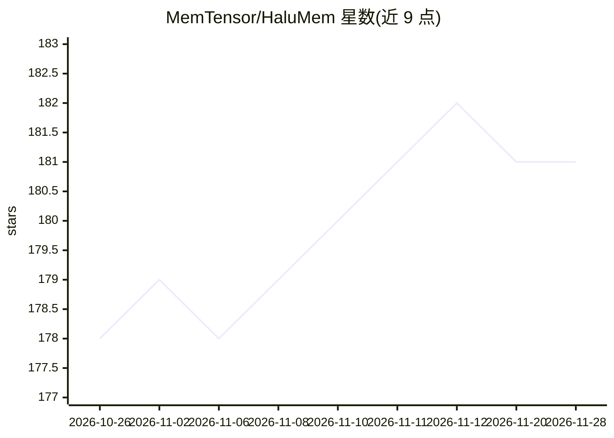

# MemTensor/HaluMem

⭐ 181 · Python · NOASSERTION · 推送 2026-10-28 · [GitHub](https://github.com/MemTensor/HaluMem) · 组织维护

**面向 agent 记忆系统的操作级幻觉评测基准与评测套件**

HaluMem 将记忆系统的工作流拆解为记忆抽取、记忆更新、记忆问答三类操作，定义操作级幻觉评测任务，衡量完整性、准确性、幻觉率与遗漏率等指标。提供 Halu-Medium（约 160k token 上下文）与 Halu-Long（约 1M token、含干扰项）两个数据集版本，共 20 用户、14,948 记忆点、3,467 QA 对。README 附带对 Mem0（含 Graph 版）、Memobase、MemOS、Supermemory、Zep 的评测榜单，并在 eval/ 目录提供基于 Poetry 的评测代码流水线。论文已被 EMNLP 2026 接收。

## 筛选速览

| 维度 | 判定 | 备注 |
|---|---|---|
| AI 角色 | `ai-knowledge` | 知识聚合/清单类 |
| 许可风险 | `none` | NOASSERTION |
| 部署形态 | `None` |  |
| 模型依赖 | — | README 未给出锁定关系 |
| 硬件要求 | — | 无带数字的原话,不猜 |
| 安装摩擦 | `low` | 无编译、无系统依赖或容器化 |
| 成熟度 | — | 结构信号不足 |

## 能力要点

- 三类操作级评测任务：记忆抽取、记忆更新、记忆问答
- 两个数据集版本：Halu-Medium（~160k token）与 Halu-Long（~1M token，含干扰项）
- eval/ 目录提供标准化评测流水线，支持多种记忆系统
- 数据集公开发布于 Hugging Face，论文被 EMNLP 2026 接收

## 适用场景

- 评测自研 agent 记忆系统的幻觉表现
- 对比不同记忆系统在抽取、更新、问答三类任务上的指标
- 复现论文中记忆系统幻觉评测的实验结果

## 场景标签

`模型评测` · 领域:评测与运维

## 证据(README 行号)

> L1: HaluMem: A Comprehensive Benchmark for Evaluating Hallucinations in Memory Systems
> L34:  To address these issues, we introduce **HaluMem**, a comprehensive benchmark that defines fine-grained evaluation 
> L577: The **HaluMem** benchmark includes a complete evaluation suite located in the `eval/` directory.

## 星数曲线

2026-10-26 178 → 2026-11-28 181（+3）

---
*卡片 v1 · prompt 1.4 · 生成 2026-11-26 · 置信度 high · 依据 README sha `aae8e14c6d18` · [字段定义](../../DATASET.md)*
