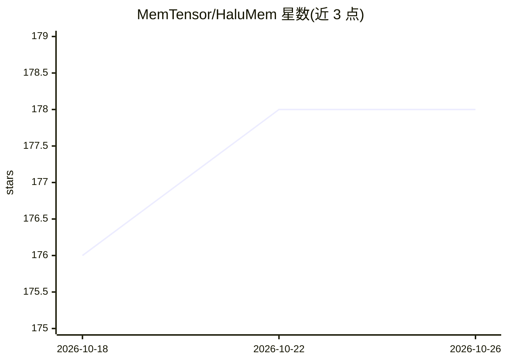

# MemTensor/HaluMem

⭐ 178 · Python · NOASSERTION · 推送 2026-09-03 · [GitHub](https://github.com/MemTensor/HaluMem) · 组织维护

**智能体记忆系统幻觉评测基准（操作级任务+数据集）**

面向 agent 记忆系统的幻觉评测基准：将记忆工作流拆解为记忆抽取、记忆更新、记忆问答三类操作级任务，度量召回、记忆准确率、幻觉率、遗漏率等指标。提供 Hugging Face 数据集（Halu-Medium 约 160k tokens、Halu-Long 约 1M tokens 上下文，各含 14,948 记忆点与 3,467 QA 对）及 eval/ 目录下的评测代码，支持 Mem0（含 Graph 版）、Memobase、MemOS、Supermemory、Zep 等多种记忆系统，用 poetry 安装依赖、配置 API key 后运行脚本评测。论文被 EMNLP 2026 主会接收，许可为 CC-BY-NC-ND-4.0。

## 筛选速览

| 维度 | 判定 | 备注 |
|---|---|---|
| AI 角色 | `ai-ecosystem` | LLM/agent 周边工具 |
| 许可风险 | `none` | NOASSERTION |
| 部署形态 | `None` |  |
| 模型依赖 | — | README 未给出锁定关系 |
| 硬件要求 | — | 无带数字的原话,不猜 |
| 安装摩擦 | `low` | 无编译、无系统依赖或容器化 |
| 成熟度 | — | 结构信号不足 |

## 能力要点

- 操作级三类任务：记忆抽取/更新/问答，量化幻觉率与遗漏率
- 两版数据集：Halu-Medium(~160k tokens)与 Halu-Long(~1M tokens 含干扰记忆)
- 评测套件支持 Mem0/Mem0-Graph/Memobase/MemOS/Supermemory/Zep
- 按事件/人物/关系三类记忆及六类问题类型细分评测

## 适用场景

- 评估自研记忆系统的幻觉抵抗能力
- 对比不同记忆系统在长上下文下的表现
- 复现论文中各记忆系统的评测结果

## 场景标签

`模型评测` · 领域:评测与运维

## 证据(README 行号)

> L35: The paper *“HaluMem: A Comprehensive Benchmark for Evaluating Hallucinations in Memory Systems”* presents the **fir
> L574: The **HaluMem** benchmark includes a complete evaluation suite located in the `eval/` directory.
> L575: It supports **multiple memory systems** and provides standardized pipelines for testing hallucination resistance a

## 星数曲线

2026-10-18 176 → 2026-10-26 178（+2）

---
*卡片 v1 · prompt 1.4 · 生成 2026-10-22 · 置信度 high · 依据 README sha `60cde3914310` · [字段定义](../../DATASET.md)*
