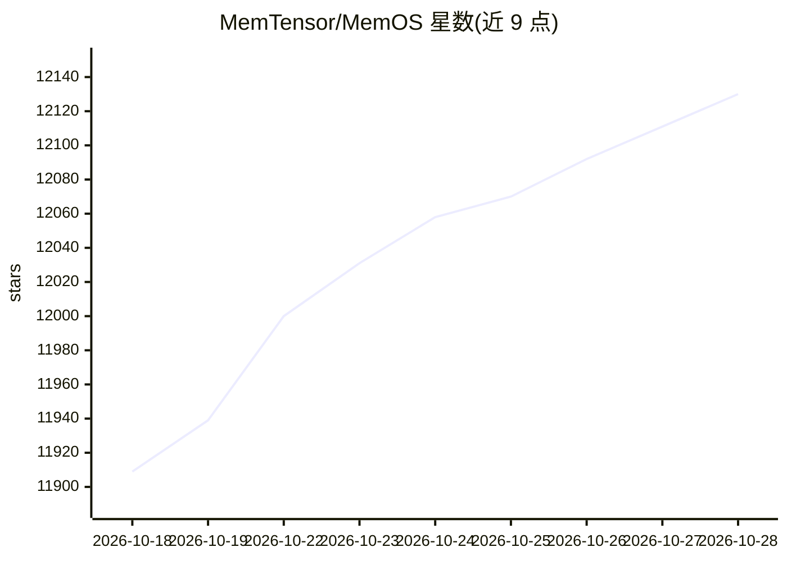

# MemTensor/MemOS

⭐ 12,130 · TypeScript · Apache-2.0 · 推送 2026-10-27 · [GitHub](https://github.com/MemTensor/MemOS) · [官网](https://memos.openmem.net) · 组织维护 · 中文 README

**为 LLM 与 AI Agent 提供长期记忆的内存操作系统**

面向 LLM 应用与 AI agent 的记忆管理系统：统一记忆的存储/检索/编辑 API，以图结构组织、支持文本/图像/工具轨迹/人设等多模态记忆，多个知识库以可组合的记忆立方体管理，异步调度器支持高并发。提供四种接入方式：托管 Cloud API、Docker/uvicorn 自托管（依赖 Neo4j 与 Qdrant）、OpenClaw/DeepSeek Harness 云插件、以及基于 SQLite 的本地插件（FTS5+向量混合检索）。本地插件需 Node.js 与已安装的目标 agent。

## 筛选速览

| 维度 | 判定 | 备注 |
|---|---|---|
| AI 角色 | `ai-ecosystem` | LLM/agent 周边工具 |
| 许可风险 | `permissive` | Apache-2.0 |
| 部署形态 | `self-host` | docker 或自建部署 |
| 模型依赖 | locked-api |  |
| 硬件要求 | — | 无带数字的原话,不猜 |
| 安装摩擦 | `low` | 无编译、无系统依赖或容器化 |
| 成熟度 | — | 结构信号不足 |

## 能力要点

- 统一记忆 API：图结构、可检查可编辑的记忆管理
- 多模态记忆与多知识库（memory cubes）隔离/共享管理
- 自托管依赖 Neo4j + Qdrant，本地插件用 SQLite（FTS5+向量混合检索）
- 为 OpenClaw / Hermes / DeepSeek Harness 提供官方云与本地插件

## 适用场景

- 给 AI 助手加上跨会话的长期记忆
- 客服系统回忆历史工单与用户记录
- 多 agent 协作中共享或隔离记忆
- 在本地设备上为 DeepSeek Harness / OpenClaw / Hermes 保留全部记忆数据

## 场景标签

`Agent 记忆` · 领域:Agent 开发

## 证据(README 行号)

> L28: **MemOS** is a Memory Operating System for LLMs and AI agents that unifies **store / retrieve / manage** for long-t
> L32: - **Unified Memory API**: A single API to add, retrieve, edit, and delete memory—structured as a graph, inspectable
> L157: MemOS gives OpenClaw, Hermes, and DeepSeek Harness a shared local memory core; the managed ***MemOS Cloud Plugin**

## 星数曲线

2026-10-18 11,909 → 2026-10-28 12,130（+221）

---
*卡片 v1 · prompt 1.4 · 生成 2026-10-20 · 置信度 high · 依据 README sha `bafbb1eb25c2` · [字段定义](../../DATASET.md)*
