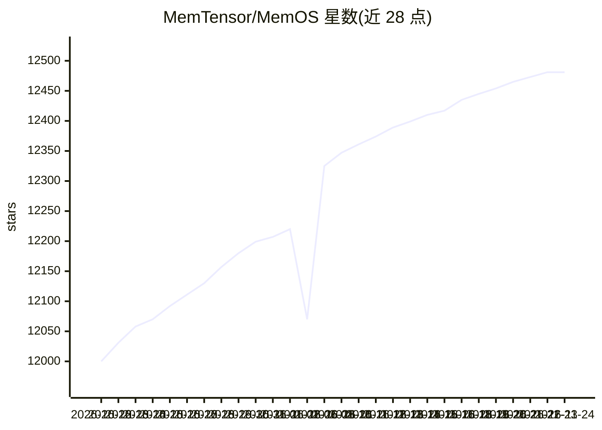

# MemTensor/MemOS

⭐ 12,481 · TypeScript · Apache-2.0 · 推送 2026-11-20 · [GitHub](https://github.com/MemTensor/MemOS) · [官网](https://memos.openmem.net) · 组织维护 · 中文 README

**为 LLM 与 AI Agent 提供长期记忆的存储/检索/管理系统**

MemOS 是面向 LLM 与 AI Agent 的记忆操作系统，统一记忆的存储、检索与管理，提供图结构化、可检查可编辑的记忆 API，支持文本、图像、工具轨迹、人设等多模态记忆与多知识库隔离共享。部署形态包括 Cloud API、Docker 自托管 REST 服务（依赖 Neo4j + Qdrant），以及面向 OpenClaw、Hermes、DeepSeek Harness 的云端与本地插件（本地插件基于 SQLite，混合 FTS5+向量检索）。Apache 2.0 许可，附论文引用信息。

## 筛选速览

| 维度 | 判定 | 备注 |
|---|---|---|
| AI 角色 | `ai-ecosystem` | LLM/agent 周边工具 |
| 许可风险 | `permissive` | Apache-2.0 |
| 部署形态 | `self-host` | docker 或自建部署 |
| 模型依赖 | — | README 未给出锁定关系 |
| 硬件要求 | — | 无带数字的原话,不猜 |
| 安装摩擦 | `low` | 无编译、无系统依赖或容器化 |
| 成熟度 | — | 结构信号不足 |

## 能力要点

- 统一 Memory API：增删改查记忆，图结构存储非黑盒嵌入
- 多模态记忆（文本/图像/工具轨迹/人设）与多知识库隔离共享
- 四种接入形态：Cloud API、Docker 自托管、云端插件、本地插件
- 本地插件支持 FTS5+向量混合检索与分层技能演化（L1/L2/L3）

## 适用场景

- 给 AI 助手加一致的长期对话记忆
- 客服系统召回历史工单与用户记录
- 多 Agent 协作时共享或隔离记忆
- 在 DeepSeek Harness/OpenClaw/Hermes 上挂载本地持久记忆

## 场景标签

`Agent 记忆` · 领域:Agent 开发

## 证据(README 行号)

> L28: ## 👾 MemOS: Memory Operating System for LLM & AI Agents
> L30: **MemOS** is a Memory Operating System for LLMs and AI agents that unifies **store / retrieve / manage** for long-t
> L89: ||Cloud API|Self-Host|MemOS Cloud Plugin|Local Plugin|

## 星数曲线

2026-10-22 12,000 → 2026-11-24 12,481（+481）

---
*卡片 v1 · prompt 1.4 · 生成 2026-11-22 · 置信度 high · 依据 README sha `af09d5a5335d` · [字段定义](../../DATASET.md)*
