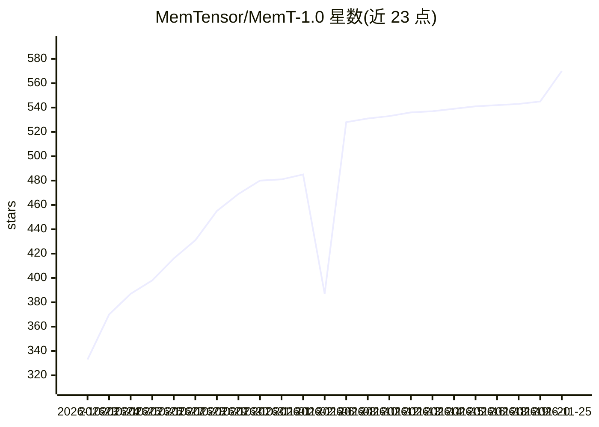

# MemTensor/MemT-1.0

⭐ 570 · Python · NOASSERTION · 推送 2026-11-20 · [GitHub](https://github.com/MemTensor/MemT-1.0) · 组织维护 · 中文 README

**记忆原生基础模型系列：以持久记忆承载长程历史对话**

MemTensor 团队发布的记忆基础模型系列，含 Nano/Flash/Pro 三个型号，分别基于 Qwen、DeepSeek、NVIDIA Nemotron 骨干。通过动态本地记忆与可训练超记忆块，在推理时不访问原始上下文即可留存历史信息，记忆状态大小恒定，官方称在 128K 历史长度下较全上下文 KV cache 约节省 66 倍存储。以 SGLang 服务端与 Python 客户端形式部署，示例用两张 GPU 启动 Nano。仓库代码采用 PolyForm Noncommercial 许可，商业使用需另行联系作者。

## 筛选速览

| 维度 | 判定 | 备注 |
|---|---|---|
| AI 角色 | `ai-native` | 本体是模型或模型工具 |
| 许可风险 | `none` | NOASSERTION |
| 部署形态 | `library` | 以包/库形式分发 |
| 模型依赖 | — | README 未给出锁定关系 |
| 硬件要求 | — | 无带数字的原话,不猜 |
| 安装摩擦 | `medium` | 含编译或系统依赖之一 |
| 成熟度 | — | 结构信号不足 |

## 能力要点

- 动态本地记忆 + 可训练超记忆的双组件架构，配 Mixture-of-Storage 扩展容量
- 持久记忆状态大小恒定，128K 历史下较全上下文 KV cache 约省 66 倍存储
- 支持会话记忆快照保存与恢复（save_state/restore）
- 面向长程编码任务的经验引导 agent 框架

## 适用场景

- 需要跨会话保留长期记忆的对话应用
- 长历史上下文下控制推理存储开销
- 复用历史过程经验的长程编码 agent 任务

## 场景标签

`Agent 框架` `Agent 记忆` · 领域:Agent 开发

## 证据(README 行号)

> L15: **MemT-1.0 is a new generation of memory foundation models that makes persistent, dynamically evolving memory an in
> L61: The examples below serve MemT-1.0-Nano with SGLang and use the `memt_sglang` Python client for conversations with n
> L69: uv pip install '.[server]'

## 星数曲线

2026-10-23 333 → 2026-11-25 570（+237）

---
*卡片 v1 · prompt 1.4 · 生成 2026-11-25 · 置信度 high · 依据 README sha `4d9929fc3320` · [字段定义](../../DATASET.md)*
