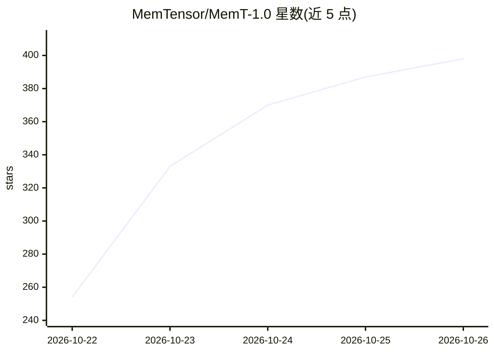

# MemTensor/MemT-1.0

⭐ 398 · Python · NOASSERTION · 推送 2026-10-20 · [GitHub](https://github.com/MemTensor/MemT-1.0) · 组织维护 · 中文 README

**持久原生记忆基础模型：让 LLM 具备固定大小的演化记忆**

MemT-1.0 是记忆基础模型系列，含 Nano（基于 Qwen3.6-35B-A3B，激活 3B）与 Flash（基于 DeepSeek-V4-Flash，激活 17B）两个规模。模型通过局部记忆块与可训练的超记忆块在推理时保留历史信息而无需回看原始上下文，持久状态大小恒定，128K 历史长度下相比全上下文 KV cache 约减少 66 倍存储。提供 SGLang 服务端部署与 memt_sglang Python 客户端，支持记忆快照保存/恢复与经验引导的 agent 编程；仓库软件采用 PolyForm Noncommercial 许可，不许可商用。

## 筛选速览

| 维度 | 判定 | 备注 |
|---|---|---|
| AI 角色 | `ai-native` | 本体是模型或模型工具 |
| 许可风险 | `none` | NOASSERTION |
| 部署形态 | `library` | 以包/库形式分发 |
| 模型依赖 | — | README 未给出锁定关系 |
| 硬件要求 | — | 无带数字的原话,不猜 |
| 安装摩擦 | `medium` | 含编译或系统依赖之一 |
| 成熟度 | — | 结构信号不足 |

## 能力要点

- 固定大小持久记忆状态，128K 历史下存储约减少 66 倍（对比全上下文 KV cache）
- Nano/Flash 双规模：激活参数 3B / 17B，可训练记忆参数 451M / 3.61B
- SGLang 服务端 + memt_sglang 客户端，支持记忆快照保存与恢复
- 经验引导的 agent 编程框架：经验存入原生记忆经记忆注意力读取

## 适用场景

- 长历史多轮对话中保留记忆且不回看原始上下文
- 长时程编程任务中复用过程性经验提升表现
- 研究参数化记忆方法与记忆缩放规律

## 场景标签

`Agent 记忆` · 领域:Agent 开发

## 证据(README 行号)

> L12: **MemT-1.0 is a new generation of memory foundation models that makes persistent, dynamically evolving memory an in
> L28: |MemT-1.0-Nano|Qwen3.6-35B-A3B|36B|3B|451M|10M|
> L29: |MemT-1.0-Flash|DeepSeek-V4-Flash|288B|17B|3.61B|336M|

## 星数曲线

2026-10-22 254 → 2026-10-26 398（+144）

---
*卡片 v1 · prompt 1.4 · 生成 2026-10-22 · 置信度 high · 依据 README sha `0e0ffcbf322b` · [字段定义](../../DATASET.md)*
