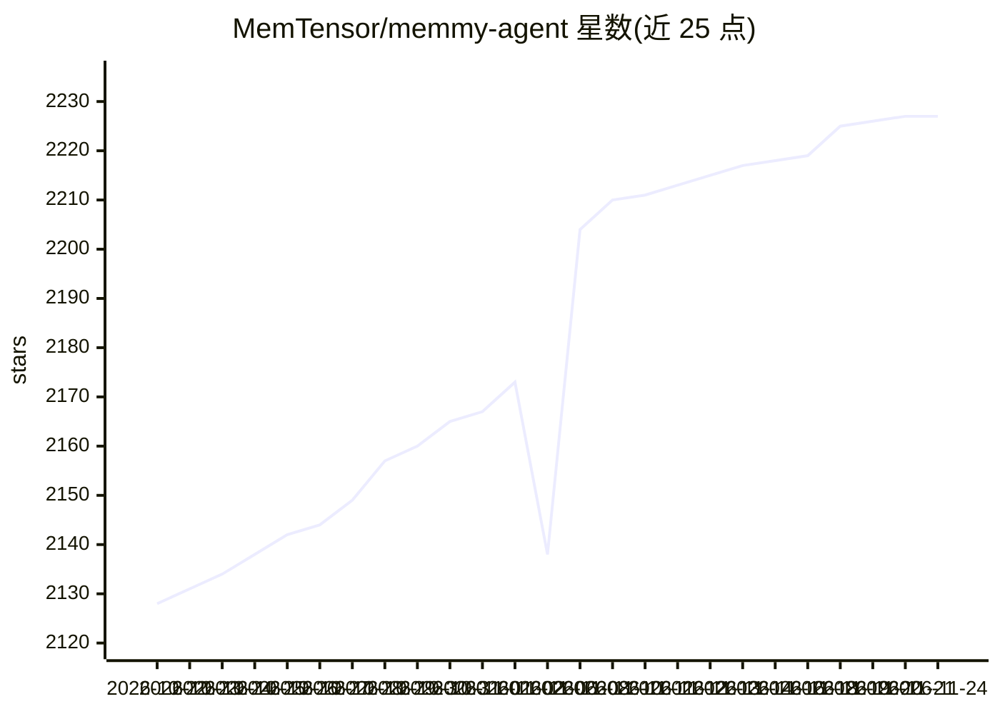

# MemTensor/memmy-agent

⭐ 2,229 · TypeScript · MIT · 推送 2026-11-24 · [GitHub](https://github.com/MemTensor/memmy-agent) · [官网](https://memmy.bot) · 组织维护 · 中文 README

**为多个 AI Agent 提供共享本地记忆与持久上下文的工具**

Memmy Agent 把用户与各 AI 工具的协作历史整理为结构化记忆，存于本地 Memory 服务，供 Claude Code、Codex、Cursor 等多个 Agent 共享，实现跨工具的任务续接与上下文携带。本身含 Agent 运行时，可组织信息并继续未完成任务。提供桌面应用、memmy CLI/TUI、memmy-memory CLI 三种入口，并以 systemd 用户服务在本地运行 Memory Service 与 Gateway；BYOK 模式可接用户自有模型 API，注册赠送的试用 token 用尽后需切换。

## 筛选速览

| 维度 | 判定 | 备注 |
|---|---|---|
| AI 角色 | `ai-ecosystem` | LLM/agent 周边工具 |
| 许可风险 | `permissive` | MIT |
| 部署形态 | `library` | 以包/库形式分发 |
| 模型依赖 | — | README 未给出锁定关系 |
| 硬件要求 | — | 无带数字的原话,不猜 |
| 安装摩擦 | `low` | 无编译、无系统依赖或容器化 |
| 成熟度 | — | 结构信号不足 |

## 能力要点

- 跨 Agent 共享本地记忆：DeepSeek Harness、Claude Code、Codex、Cursor 等均可接入
- memmy-memory CLI 支持从脚本与 Agent 读写本地记忆服务（默认 127.0.0.1:18960）
- memmy serve 提供 OpenAI 兼容 API（:18990）
- BYOK 模式：试用 token 耗尽后使用用户自有模型 API

## 适用场景

- 在 Claude Code 与 Codex 等工具间切换时保留项目背景与进度
- 为多个 AI Agent 提供统一的本地持久记忆
- 单独运行本地记忆服务供脚本与调试流程调用

## 场景标签

`Agent 记忆` `编码 Agent` · 领域:Agent 开发

## 证据(README 行号)

> L22:  Remember: Memmy remembers what you said and turns your local AI collaboration history into structured memory
> L32: **DeepSeek Harness, OpenClaw, Hermes, Claude Code, Codex, Cursor, WorkBuddy, OpenCode, Pi...they all work!**
> L68: The installer enables the local Memory Service immediately as `memmy-memory.service`. The first bare `memmy` invoca

## 星数曲线

2026-10-22 2,128 → 2026-11-24 2,227（+99）

---
*卡片 v1 · prompt 1.4 · 生成 2026-11-23 · 置信度 high · 依据 README sha `570e8d98ff0b` · [字段定义](../../DATASET.md)*
