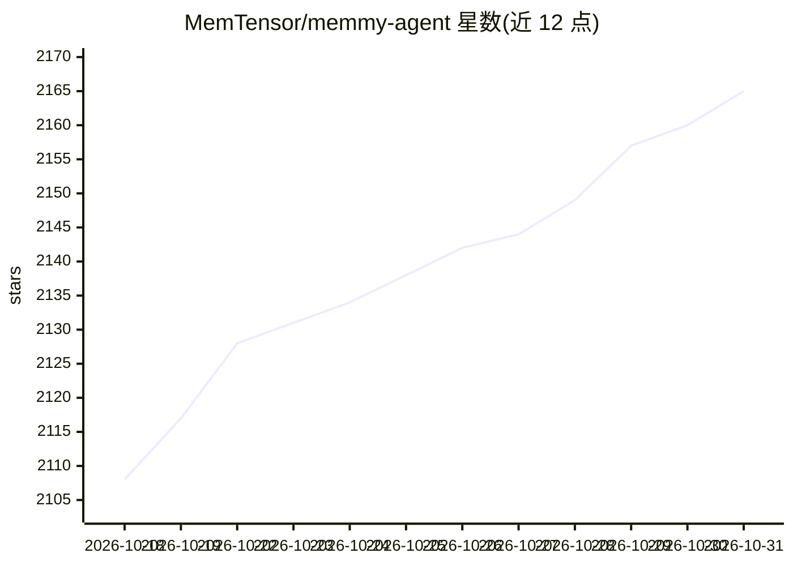

# MemTensor/memmy-agent

⭐ 2,165 · TypeScript · MIT · 推送 2026-10-30 · [GitHub](https://github.com/MemTensor/memmy-agent) · [官网](https://memmy.bot) · 组织维护 · 中文 README

**为所有 AI agent 提供共享本地记忆与持久上下文的个人 agent**

面向使用多个 AI 编码/助手工具的用户，Memmy 把本地 AI 协作历史转化为结构化记忆，让 DeepSeek Harness、Claude Code、Codex、Cursor 等不同 agent 共享同一份项目背景、偏好与进度，实现跨工具任务续接；本体也包含可执行任务的 Agent。以 systemd 用户服务运行本地 Memory Service 与 Gateway，提供桌面应用、CLI/TUI、memmy-memory 命令行与 OpenAI 兼容 API（:18990）。注册赠试用额度，耗尽后切换 BYOK 模式使用自有模型 API；Linux 安装需 Node.js 22+ 与 systemd 用户会话。

## 筛选速览

| 维度 | 判定 | 备注 |
|---|---|---|
| AI 角色 | `ai-ecosystem` | LLM/agent 周边工具 |
| 许可风险 | `permissive` | MIT |
| 部署形态 | `library` | 以包/库形式分发 |
| 模型依赖 | — | README 未给出锁定关系 |
| 硬件要求 | — | 无带数字的原话,不猜 |
| 安装摩擦 | `low` | 无编译、无系统依赖或容器化 |
| 成熟度 | — | 结构信号不足 |

## 能力要点

- 本地 Memory Service 供多 agent 共享同一份结构化记忆
- 为已检测 agent 安装 Memory Skill 与 Hook/插件（memmy-memory init）
- 提供 OpenAI 兼容 API（:18990）与交互式 TUI、onboard 向导
- BYOK 模式：试用额度耗尽后改用自有模型 API

## 适用场景

- 在 Claude Code、Codex、Cursor 等工具间切换而不丢失上下文
- 让多个 AI agent 记住同一份偏好与项目进度
- 单独运行本地记忆服务供脚本和 agent 调用

## 场景标签

`Agent 记忆` `AI 助手` · 领域:Agent 开发

## 证据(README 行号)

> L22:  Remember: Memmy remembers what you said and turns your local AI collaboration history into structured memory
> L32: **DeepSeek Harness, OpenClaw, Hermes, Claude Code, Codex, Cursor, WorkBuddy, OpenCode, Pi...they all work!**
> L139:  Memmy system architecture: multiple Agents and entry points share the local Memory and Agent Runtime

## 星数曲线

2026-10-18 2,108 → 2026-10-31 2,165（+57）

---
*卡片 v1 · prompt 1.4 · 生成 2026-10-21 · 置信度 high · 依据 README sha `36c5780116f7` · [字段定义](../../DATASET.md)*
