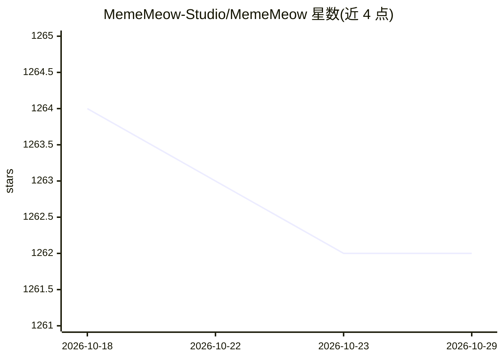

# MemeMeow-Studio/MemeMeow

⭐ 1,262 · Python · AGPL-3.0 · 推送 2026-10-12 · [GitHub](https://github.com/MemeMeow-Studio/MemeMeow) · [官网](https://mememeow.cc/home) · 组织维护 · 中文 README

**给普通用户的自然语言表情包检索工具**

面向表情包使用者的图片检索与管理服务：上传图片后可由内置 OpenCode Agent 分析出处、用法和含义并生成语境描述，或用文件名生成文本向量；检索时通过 Embedding 模型按自然语言描述（如“表达无奈”）匹配图片，另支持本地 DINOv2 视觉近邻搜索。提供 Vue 3 Web 界面与 POST /search API，可访问官网直接使用，或以 Docker Compose 本地部署（需配置 OpenCode API，下载 DINOv2 权重）。项目自述处于早期测试阶段。

## 筛选速览

| 维度 | 判定 | 备注 |
|---|---|---|
| AI 角色 | `ai-native` | 本体是模型或模型工具 |
| 许可风险 | `viral` | AGPL-3.0 |
| 部署形态 | `self-host` | docker 或自建部署 |
| 模型依赖 | — | README 未给出锁定关系 |
| 硬件要求 | — | 无带数字的原话,不猜 |
| 安装摩擦 | `low` | 无编译、无系统依赖或容器化 |
| 成熟度 | `idea` | |

## 能力要点

- Agent 自动标注表情包含义并生成语境描述
- Embedding 语义检索：按场景/心情描述匹配图片
- 本地 DINOv2 视觉模型做图片相似度搜索
- 提供 Web 界面、Docker Compose 部署与 POST /search API

## 适用场景

- 忘记文件名时，用一句话描述找到合适的表情包
- 整理和自动标注个人表情包收藏
- 通过 API 把表情包检索接入其他应用或机器人

## 场景标签

`语义搜索` · 领域:知识与检索

## 证据(README 行号)

> L1: MemeMeow 是一个基于自然语言的表情包检索工具。它能自动标注表情包含义，并通过描述想要的场景或心情，快速找到合适的表情包（无需记住具体的文件名或标签）。
> L10: - **🤖 自然语言检索**: 采用 Embedding 模型，实现 Q&A 式的检索，能够根据你的描述（如“表达无奈”）找到匹配的图片。

## 星数曲线

2026-10-18 1,264 → 2026-10-29 1,262（-2）

---
*卡片 v1 · prompt 1.4 · 生成 2026-10-21 · 置信度 high · 依据 README sha `11e7cfd523d5` · [字段定义](../../DATASET.md)*
