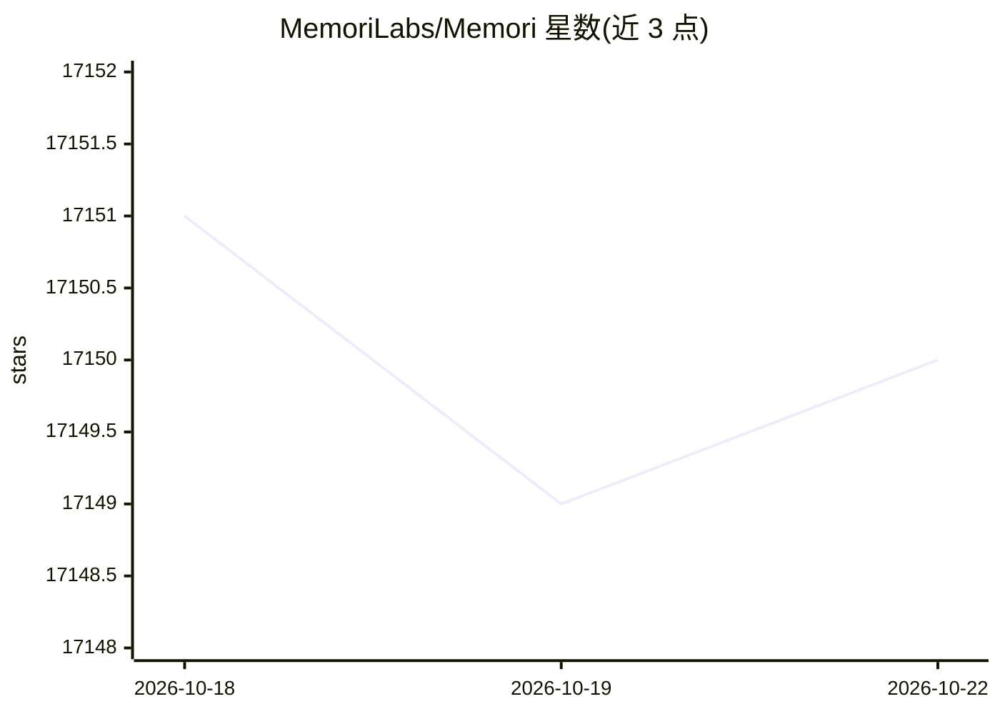

# MemoriLabs/Memori

⭐ 17,146 · Python · NOASSERTION · 推送 2026-10-03 · [GitHub](https://github.com/MemoriLabs/Memori) · [官网](https://memorilabs.ai) · 组织维护

**面向 agent 的记忆基础设施：把执行与对话转为持久化结构化记忆**

提供 Python 与 TypeScript SDK 的 agent 记忆层，将 LLM 交互与 agent 执行（含工具调用、决策、结果）捕获为按 entity/process/session 分级的结构化记忆，后台增强生成 attributes、facts、preferences 等类型，不增加请求延迟。LLM、数据存储与框架无关，支持 OpenAI 等多种 LLM 与 LangChain 等框架，可接入自有数据库（BYODB）或使用 Memori Cloud；通过 MCP 一条命令接入 Claude Code、Cursor 等客户端；默认高级增强免账号但限速。

## 筛选速览

| 维度 | 判定 | 备注 |
|---|---|---|
| AI 角色 | `ai-native` | 本体是模型或模型工具 |
| 许可风险 | `none` | NOASSERTION |
| 部署形态 | `library` | 以包/库形式分发 |
| 模型依赖 | locked-api |  |
| 硬件要求 | — | 无带数字的原话,不猜 |
| 安装摩擦 | `low` | 无编译、无系统依赖或容器化 |
| 成熟度 | — | 结构信号不足 |

## 动量与使用信号

- 维护:`active` — 距上次 push 15.3 天,年发版 32,42 位贡献者
- 涨星:近 1 天 **-2**(自 20261016 起算)
- 安装:pypi 包 `memori` 月下载 16,441
- 平台:— · 协议:MCP

## 能力要点

- entity/process/session 三级记忆归属与后台增强（attributes/facts/preferences 等）
- MCP 单命令接入 Claude Code、Cursor、Codex、Warp 等客户端，无需 SDK 集成
- LLM/datastore/framework 无关，提供 BYODB 模式接入自有数据库
- OpenClaw 插件与 Hermes 记忆 provider 两种开箱集成

## 适用场景

- 让 agent 跨会话记住用户偏好、项目约定与历史决策
- 为生产环境的 agent 系统沉淀结构化执行轨迹，减少重复工具调用
- 团队共享 coding 约定与审阅偏好上下文

## 场景标签

`Agent 记忆` · 领域:Agent 开发

## 证据(README 行号)

> L3:  Memory from what agents do, not just what they say.
> L43: Set `MEMORI_API_KEY` and your LLM API key (e.g. `OPENAI_API_KEY`), then:
> L170: ## Supported LLMs

## 星数曲线

2026-10-18 17,151 → 2026-10-22 17,150（-1）

---
*卡片 v1 · prompt 1.4 · 生成 2026-10-18 · 置信度 high · 依据 README sha `c385b3f8f7bb` · [字段定义](../../DATASET.md)*
