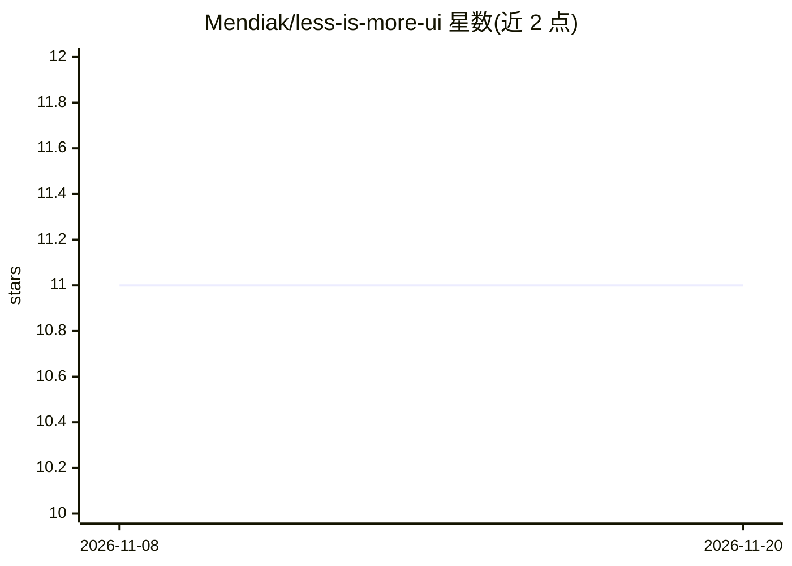

# Mendiak/less-is-more-ui

⭐ 11 · HTML · GPL-3.0 · 推送 2026-11-11 · [GitHub](https://github.com/Mendiak/less-is-more-ui) · [官网](https://mendiak.github.io/less-is-more-ui/) · 个人维护

**为 AI agent 提供极简主义网页 UI 设计技能与 CSS 系统**

由设计令牌、CSS reset 与可复用组件构成的极简设计系统，并附一套可被 agent 应用的设计原则文档。提供两种使用方式：通过 npx 将 SKILL.md、原则文档与令牌安装到 agent 的 skills 目录，使“简化仪表盘”类提示默认应用该体系；或作为 npm CSS 包引入项目。含类型比例、8px 间距标尺、中性色板、深浅主题及按钮/输入/卡片等组件，本地开发需 Node 18+，无额外依赖，采用 GPL v3.0 许可。

## 筛选速览

| 维度 | 判定 | 备注 |
|---|---|---|
| AI 角色 | `ai-enhanced` | 去掉 AI 部分产品仍成立 |
| 许可风险 | `viral` | GPL-3.0 |
| 部署形态 | `library` | 以包/库形式分发 |
| 模型依赖 | — | README 未给出锁定关系 |
| 硬件要求 | — | 无带数字的原话,不猜 |
| 安装摩擦 | `low` | 无编译、无系统依赖或容器化 |
| 成熟度 | — | 结构信号不足 |

## 能力要点

- npx skills add 安装 SKILL.md、原则文档与设计令牌到 agent skills 目录
- 设计令牌：字号比例、8px 间距、中性色板、语义别名与深/浅主题
- npm 包形式提供 tokens + reset + components 三层 CSS
- 生成 llms.txt 与 llms-full.txt 供 agent 读取的文档索引

## 适用场景

- 让 agent 按 Less Is More 原则重构或简化仪表盘页面
- 项目直接引入 CSS 包获得统一的设计令牌与组件
- 要求 agent 仅用语义 HTML 与标尺变量构建表单

## 场景标签

 · 领域:前端/设计系统

## 证据(README 行号)

> L9: A minimalist design system and an AI agent skill for calm, functional web interfaces. Design tokens, a CSS reset and
> L34: npx skills add Mendiak/less-is-more-ui
> L42: npm install @mendiak/less-is-more-ui

## 星数曲线

2026-11-08 11 → 2026-11-20 11（+0）

---
*卡片 v1 · prompt 1.4 · 生成 2026-11-19 · 置信度 high · 依据 README sha `3f5bfd98a311` · [字段定义](../../DATASET.md)*
