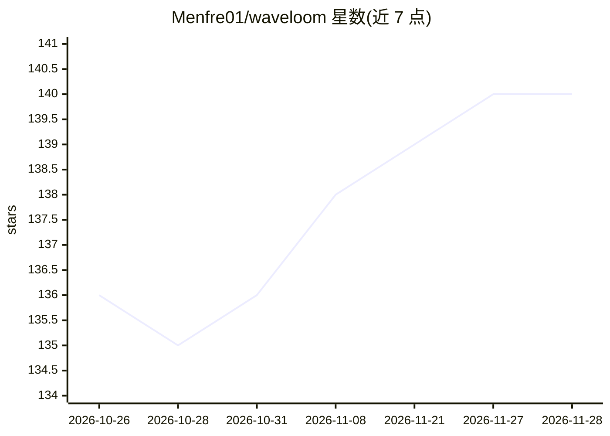

# Menfre01/waveloom

⭐ 140 · Go · Apache-2.0 · 推送 2026-11-09 · [GitHub](https://github.com/Menfre01/waveloom) · [官网](https://github.com/Menfre01/waveloom) · 个人维护 · 中文 README

**面向 DeepSeek 前缀缓存优化的终端编码 Agent（Go）**

纯 Go 编写的终端编码 Agent，围绕 DeepSeek 前缀缓存设计：固定系统提示词、只追加消息历史、四级水位压缩，使最长公共前缀跨轮次保持缓存命中（README 称 95-99%）。内置 14 个工具（读写编辑/bash/搜索/子代理等）、计划模式、会话持久化、检查点回退、Hook 系统、OS 级沙箱（bubblewrap/Seatbelt）、MCP 客户端与 `.claude/skills/` 配置兼容。通过 API key 直连模型服务商，每步写操作需用户确认。

## 筛选速览

| 维度 | 判定 | 备注 |
|---|---|---|
| AI 角色 | `ai-native` | 本体是模型或模型工具 |
| 许可风险 | `permissive` | Apache-2.0 |
| 部署形态 | `desktop` | 安装包/桌面程序 |
| 模型依赖 | locked-api |  |
| 硬件要求 | — | 无带数字的原话,不猜 |
| 安装摩擦 | `low` | 无编译、无系统依赖或容器化 |
| 成熟度 | — | 结构信号不足 |

## 能力要点

- 前缀缓存优化：固定 System Prompt + 四级水位压缩，压缩字节不变
- 14 个内置工具与 MCP 客户端，兼容 `.claude/skills/` 与 `.claude.json`
- 三级权限决策 + 5 层工具输出安全管线，写操作需确认
- OS 级沙箱（bubblewrap/Seatbelt）与会话持久化、检查点回退

## 适用场景

- 在终端中让 AI 代理读写与编辑代码并执行命令
- 使用 DeepSeek API 时降低缓存未命中带来的 token 成本
- 复用已有的 Claude Code skills/MCP 配置迁移工作流

## 场景标签

`编码 Agent` · 领域:编码与开发

## 证据(README 行号)

> L14: **A DeepSeek-native terminal code agent engineered for cache economics.** Prefix-cache architecture keeps the longe
> L16: **DeepSeek 原生终端编码代理，围绕缓存经济学设计。** 前缀缓存架构让最长公共前缀跨轮次持续命中；LLM 自动按任务选模型——pro 做深度推理，flash 处理常规任务——最大化缓存命中，最小化 token 成本。专业
> L84: - **Prefix cache optimized** — Fixed System Prompt, append-only message history, four-tier watermark compaction. Ma

## 星数曲线

2026-10-26 136 → 2026-11-28 140（+4）

---
*卡片 v1 · prompt 1.4 · 生成 2026-11-27 · 置信度 mid · 依据 README sha `ddd7674cfd6c` · [字段定义](../../DATASET.md)*
