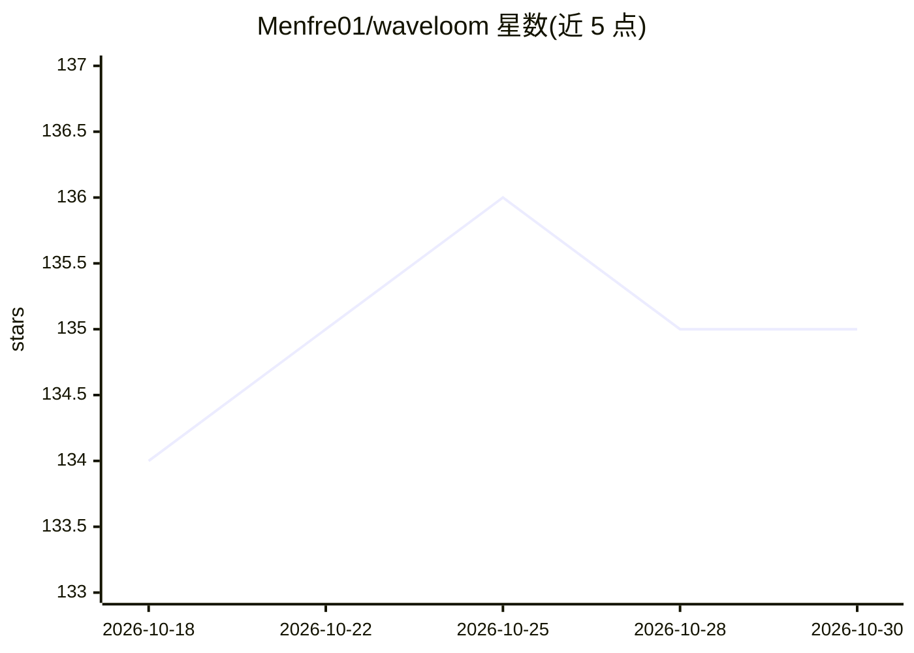

# Menfre01/waveloom

⭐ 135 · Go · Apache-2.0 · 推送 2026-09-14 · [GitHub](https://github.com/Menfre01/waveloom) · [官网](https://github.com/Menfre01/waveloom) · 个人维护 · 中文 README

**面向 DeepSeek 前缀缓存优化的 Go 终端编码 Agent**

用 Go 编写的单一二进制终端编码代理，围绕 DeepSeek 前缀缓存设计：固定 System Prompt、追加式消息历史与四级水位压缩，使最长公共前缀跨轮保持缓存命中以降低 token 成本；LLM 自动在 pro（深度推理）与 flash（常规任务/多模态）间选模型。支持 DeepSeek/Kimi/GLM/OpenAI 直连，兼容 .claude/skills 与 .claude.json MCP 配置，提供 14 个内置工具、沙箱隔离、Hook、会话持久化与检查点回滚，双语 TUI。安装方式含 curl 脚本与 Homebrew，Windows 需 Git Bash 或 WSL2。

## 筛选速览

| 维度 | 判定 | 备注 |
|---|---|---|
| AI 角色 | `ai-native` | 本体是模型或模型工具 |
| 许可风险 | `permissive` | Apache-2.0 |
| 部署形态 | `desktop` | 安装包/桌面程序 |
| 模型依赖 | locked-api |  |
| 硬件要求 | — | 无带数字的原话,不猜 |
| 安装摩擦 | `low` | 无编译、无系统依赖或容器化 |
| 成熟度 | — | 结构信号不足 |

## 能力要点

- DeepSeek 前缀缓存架构：固定 System Prompt、追加式历史、四级水位压缩
- LLM 自动在 pro 与 flash 间按任务选模型
- 兼容 .claude/skills/ 与 .claude/plugins/ 配置及完整 MCP 客户端
- OS 级沙箱（bubblewrap/Seatbelt）与 5 层工具输出安全管线

## 适用场景

- 在终端里让 AI 直接读写代码、执行命令完成开发任务
- 使用 DeepSeek 时降低多轮对话的 token 成本
- 迁移已有的 Claude Code 技能与 MCP 配置

## 场景标签

`编码 Agent` · 领域:编码与开发

## 证据(README 行号)

> L14: **A DeepSeek-native terminal code agent engineered for cache economics.** Prefix-cache architecture keeps the longe
> L84: - **Prefix cache optimized** — Fixed System Prompt, append-only message history, four-tier watermark compaction. Ma

## 星数曲线

2026-10-18 134 → 2026-10-30 135（+1）

---
*卡片 v1 · prompt 1.4 · 生成 2026-10-22 · 置信度 mid · 依据 README sha `955230e25274` · [字段定义](../../DATASET.md)*
