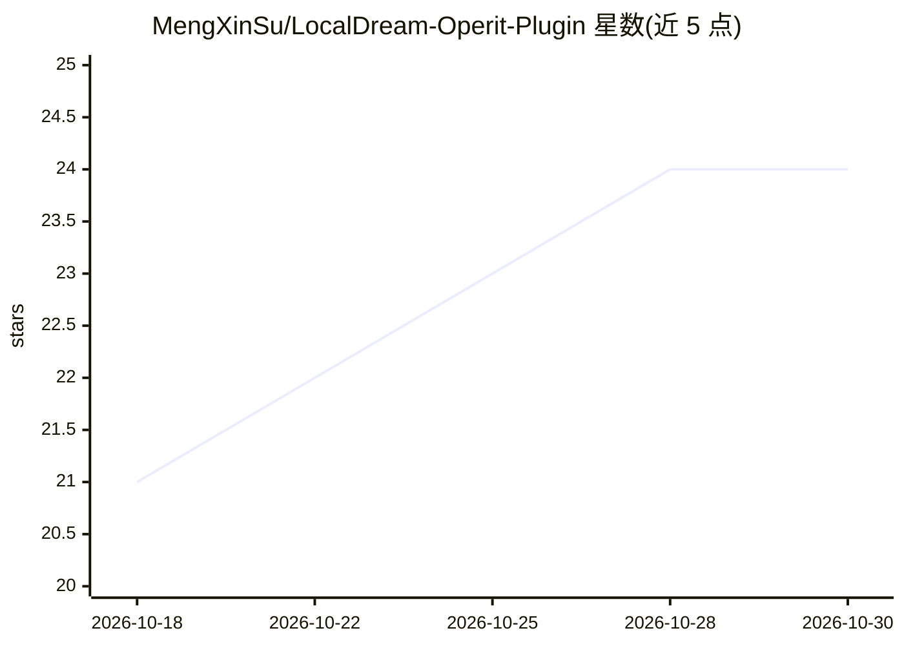

# MengXinSu/LocalDream-Operit-Plugin

⭐ 24 · JavaScript · GPL-3.0 · 推送 2026-08-13 · [GitHub](https://github.com/MengXinSu/LocalDream-Operit-Plugin) · 个人维护 · 中文 README

**手机本地 AI 生图插件：在 Operit 平台离线运行 Stable Diffusion**

Operit 平台的生图插件，在安卓手机本地运行 Stable Diffusion（SD1.5 / SDXL），无需联网，通过骁龙 NPU 加速，也支持 CPU/GPU 推理，支持自定义正向/反向提示词。以插件目录形式手动放入 Operit 的 dev_package 目录安装，或通过 AI 助手自动安装。需保持 APP 后台运行避免被系统清理；首次生图因需编译 Shader 较慢。项目采用 GPL-3.0 许可证，代码由 AI 生成。

## 筛选速览

| 维度 | 判定 | 备注 |
|---|---|---|
| AI 角色 | `ai-native` | 本体是模型或模型工具 |
| 许可风险 | `viral` | GPL-3.0 |
| 部署形态 | `None` |  |
| 模型依赖 | — | README 未给出锁定关系 |
| 硬件要求 | — | 无带数字的原话,不猜 |
| 安装摩擦 | `low` | 无编译、无系统依赖或容器化 |
| 成熟度 | — | 结构信号不足 |

## 能力要点

- 手机本地运行 Stable Diffusion（SD1.5 / SDXL），无需联网
- 骁龙 NPU 加速，支持 CPU/GPU 推理
- 支持自定义正向/反向提示词

## 适用场景

- 在手机上离线生成图片，保护隐私
- 在 Operit 对话中调用生图工具自动生成图片

## 场景标签

`图像生成` · 领域:内容生成

## 证据(README 行号)

> L7: 在手机项地运行 Stable Diffusion，无需联网，保护隐私。
> L11: - 🖼️ 手机项地AI生图（SD1.5 / SDXL）

## 星数曲线

2026-10-18 21 → 2026-10-30 24（+3）

---
*卡片 v1 · prompt 1.4 · 生成 2026-10-27 · 置信度 high · 依据 README sha `ea8e91021ecb` · [字段定义](../../DATASET.md)*
