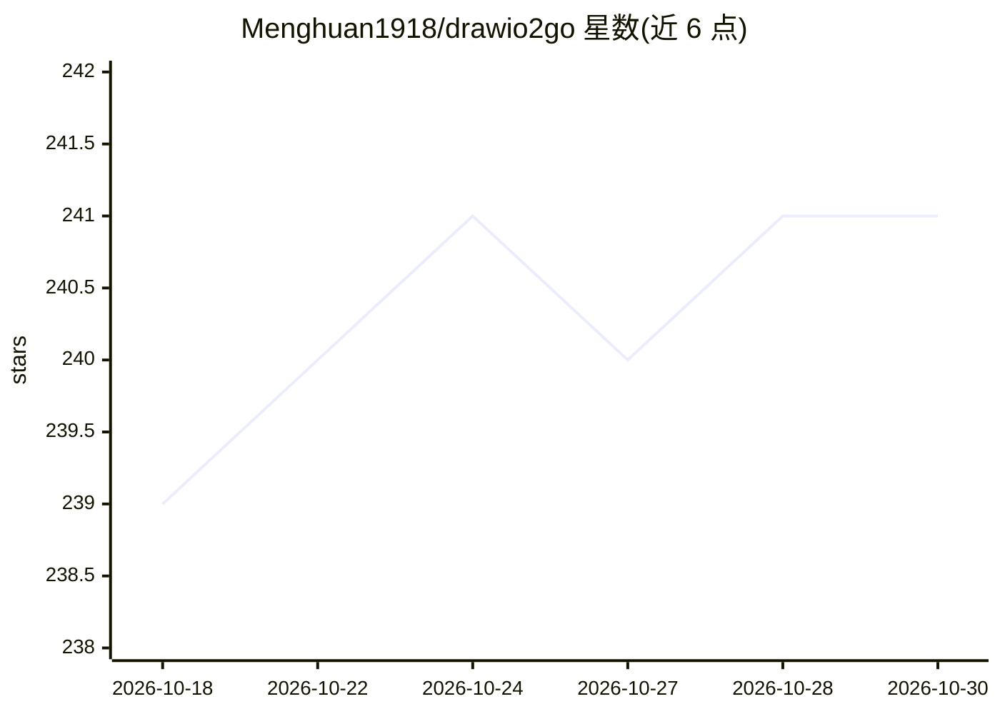

# Menghuan1918/drawio2go

⭐ 241 · TypeScript · MIT · 推送 2026-01-04 · [GitHub](https://github.com/Menghuan1918/drawio2go) · [官网](https://drawio2go.vercel.app) · 个人维护 · 中文 README

**带 AI 协作绘图的 DrawIO 编辑器（Electron/Web）**

基于 Next.js/React/Electron 的 DrawIO 图表编辑器，核心功能是多页画布编辑、版本管理与版本对比回滚；AI 部分支持通过 LLM API（OpenAI/DeepSeek/Anthropic/Gemini 格式）对话式生成与修改图表，提供 XPath 精确增删改查工具、画布选区上下文注入、版本自动创建，并可启动 MCP 服务供其他应用连接。提供 Windows/macOS/Linux 安装包或 Web 部署（需 Node.js 22+）；Web 端不支持鼠标选区感知，多用户部署未测试，存在已知问题列表。

## 筛选速览

| 维度 | 判定 | 备注 |
|---|---|---|
| AI 角色 | `ai-enhanced` | 去掉 AI 部分产品仍成立 |
| 许可风险 | `permissive` | MIT |
| 部署形态 | `library` | 以包/库形式分发 |
| 模型依赖 | — | README 未给出锁定关系 |
| 硬件要求 | — | 无带数字的原话,不猜 |
| 安装摩擦 | `low` | 无编译、无系统依赖或容器化 |
| 成熟度 | — | 结构信号不足 |

## 能力要点

- 对话式生成/修改 DrawIO 图表，XPath 精确操作以节省 token
- 画布版本管理与版本对比/回滚，支持 AI 自动建版本
- 可启动带版本管理的 MCP 服务连接其他应用
- 提供 Windows/macOS/Linux 桌面安装包或 Web 部署

## 适用场景

- 通过自然语言让 AI 生成流程图、UML 架构图
- 在多页画布上让 AI 只修改指定部分并对比回滚版本
- 把画布内容通过 MCP 服务接入其他 AI 应用

## 场景标签

 · 领域:图表/可视化工具

## 证据(README 行号)

> L15: A modern DrawIO editor application dedicated to building better **human-AI collaborative** modeling tools with AI a
> L33:  AI-Powered Modification

## 星数曲线

2026-10-18 239 → 2026-10-30 241（+2）

---
*卡片 v1 · prompt 1.4 · 生成 2026-10-22 · 置信度 high · 依据 README sha `8e40477d5067` · [字段定义](../../DATASET.md)*
