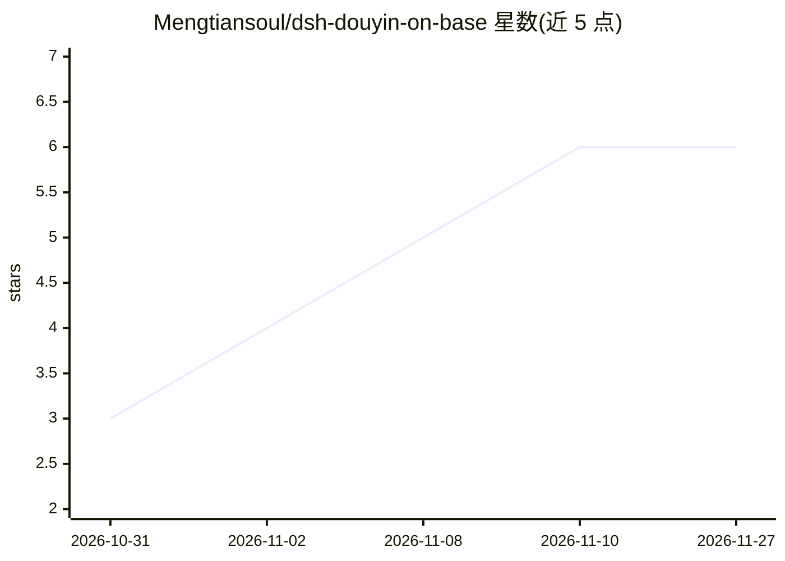

# Mengtiansoul/dsh-douyin-on-base

⭐ 6 · JavaScript · MIT · 推送 2026-10-29 · [GitHub](https://github.com/Mengtiansoul/dsh-douyin-on-base) · [官网](https://github.com/Mengtiansoul/dsh-douyin-on-base#readme) · 个人维护 · 中文 README

**DSH 抖音插件：AI 刷推荐流互动与自动收发私信群聊**

作为 DSH 的插件，将抖音自动化拆成两个模块：内容模块由 star-browser 管家驱动浏览器，提供 20 余个 douyin_* 工具，可刷推荐流、搜索、截图，并调用 OpenAI 兼容视觉模型对画面打分以决定自动点赞收藏转发；社交模块通过 douyin-im 纯 Node 直连 WSS 收发私信与群消息，经 HTTP 3099 会话桥把消息投给 DSH 会话取回回复后发回抖音，支持白名单、回复上限、会话持久化与独立工作区。守卫/看门狗/定时脚本为 Windows PowerShell，非 Windows 需自行替代。

## 筛选速览

| 维度 | 判定 | 备注 |
|---|---|---|
| AI 角色 | `ai-native` | 本体是模型或模型工具 |
| 许可风险 | `permissive` | MIT |
| 部署形态 | `library` | 以包/库形式分发 |
| 模型依赖 | — | README 未给出锁定关系 |
| 硬件要求 | — | 无带数字的原话,不猜 |
| 安装摩擦 | `low` | 无编译、无系统依赖或容器化 |
| 成熟度 | — | 结构信号不足 |

## 能力要点

- 20 余个 douyin_* 工具：刷流、搜索、截图、点赞收藏评论转发
- 视觉模型打分（OpenAI 兼容接口）驱动自动互动
- douyin-im 纯 Node 直连 WSS 收发私信群聊，不依赖浏览器
- 白名单、每日回复上限、会话持久化与日报生成

## 适用场景

- 让 DSH Agent 代替自己刷抖音推荐流并自动点赞收藏
- 在抖音私信/群聊里接入 AI 自动回复
- 每天生成口语化的刷视频日报

## 场景标签

`浏览器自动化` `聊天机器人` · 领域:效率与自动化

## 证据(README 行号)

> L3: 给 DSH 用的抖音插件：把「刷视频」和「回消息」拆成两个互不干扰的模块。
> L20: |`douyin_evaluate`|截图 + 视觉模型打分（可自动互动）|
> L31: `social/bridge.mjs` 用 douyin-im 登录后监听消息，通过 `session-bridge.mjs`（HTTP 3099）投进真正的 DSH 会话，

## 星数曲线

2026-10-31 3 → 2026-11-27 6（+3）

---
*卡片 v1 · prompt 1.4 · 生成 2026-11-20 · 置信度 high · 依据 README sha `bc992d8d1d9b` · [字段定义](../../DATASET.md)*
