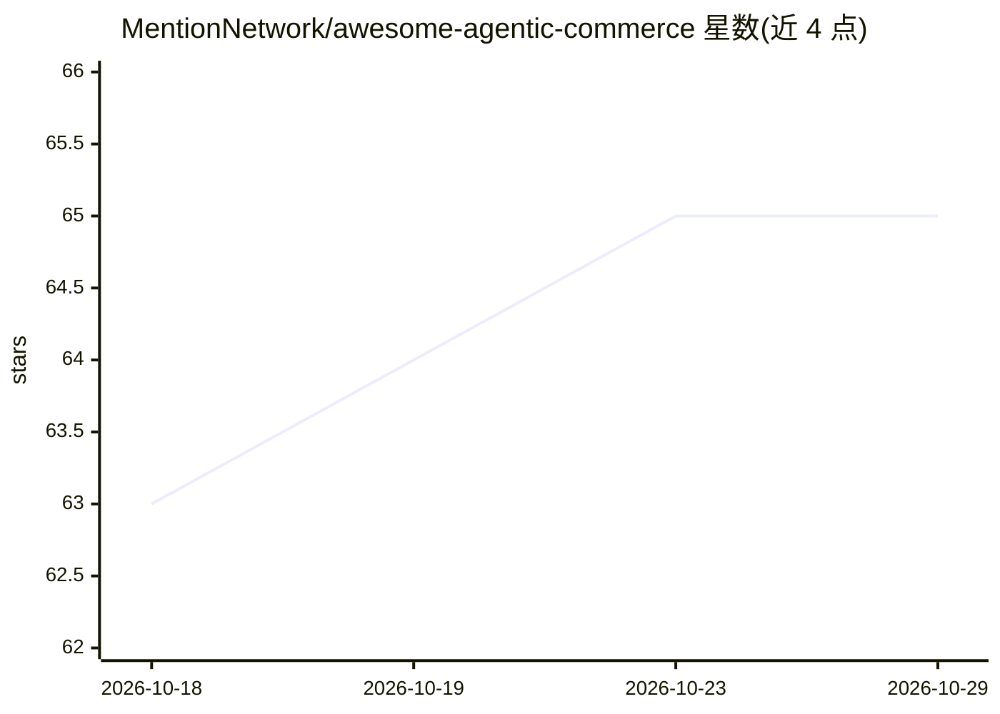

# MentionNetwork/awesome-agentic-commerce

⭐ 65 · CC0-1.0 · 推送 2026-07-20 · [GitHub](https://github.com/MentionNetwork/awesome-agentic-commerce) · [官网](https://mention.network) · 组织维护

**AI 代理电商资源策展清单：协议、MCP 服务与平台工具**

由 MentionNetwork 维护的 agentic commerce 策展清单：汇集 UCP、ACP、AP2、MCP 四类协议规范与对比表，覆盖店铺 AI 就绪测试工具、跨平台 MCP 服务器，以及 Shopify、WooCommerce、BigCommerce、Adobe Commerce 等平台的 SDK、插件与学习资源；每个分类附 articles/ 延伸阅读文件，并提供术语表（UCP/ACP/AP2/MCP、GEO/AEO、llms.txt）。面向店主、开发者、代理机构与营销人员。

## 筛选速览

| 维度 | 判定 | 备注 |
|---|---|---|
| AI 角色 | `ai-knowledge` | 知识聚合/清单类 |
| 许可风险 | `viral` | CC0-1.0 |
| 部署形态 | `None` |  |
| 模型依赖 | — | README 未给出锁定关系 |
| 硬件要求 | — | 无带数字的原话,不猜 |
| 安装摩擦 | `low` | 无编译、无系统依赖或容器化 |
| 成熟度 | — | 结构信号不足 |

## 能力要点

- UCP/ACP/AP2/MCP 四协议的对比表与规范链接
- 覆盖 Shopify 与 WooCommerce 的分类资源（API、插件、MCP、社区）
- 含 Agent 就绪测试工具与 AI 订单市场数据
- 每类附 articles/ 延伸阅读与入门术语表

## 适用场景

- 查找 agentic commerce 协议规范与平台接入资源
- 评估与测试店铺对 AI 购物代理的就绪度
- 为 Shopify/WooCommerce 店铺挑选支持 AI 代理的插件与 MCP 服务器

## 场景标签

`精选清单` · 领域:学习与行业

## 证据(README 行号)

> L5: > A curated list of awesome resources for agentic commerce — the protocols, MCP servers, tools, apps, APIs and servi
> L9: Each category also links a **📚 Further reading** file under `articles/` collecting the best writing on the topic fro

## 星数曲线

2026-10-18 63 → 2026-10-29 65（+2）

---
*卡片 v1 · prompt 1.4 · 生成 2026-10-24 · 置信度 high · 依据 README sha `c58e27762845` · [字段定义](../../DATASET.md)*
