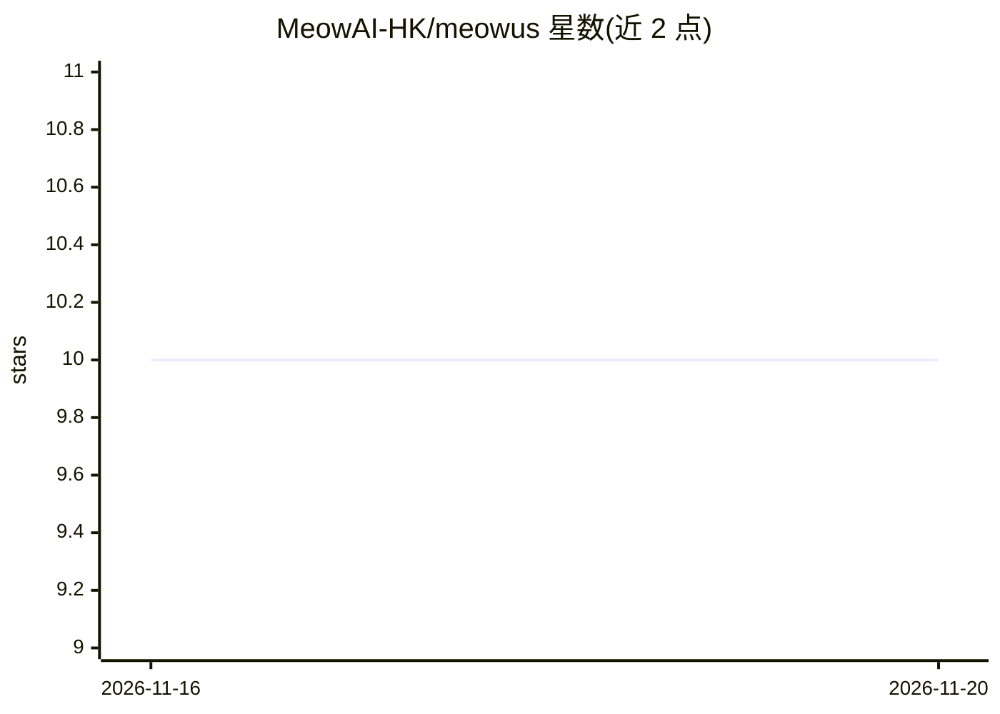

# MeowAI-HK/meowus

⭐ 10 · TypeScript · MIT · 推送 2026-07-13 · [GitHub](https://github.com/MeowAI-HK/meowus) · [官网](https://smepost.io/meowus) · 组织维护 · 中文 README

**本地运行的社交媒体 AI Agent：规划、审批、排期并发布内容**

桌面端社交媒体代理工具，由 Electron 应用与 Next.js 本地控制台组成：管理多个已登录社媒账号（每账号独立持久化 Chromium 浏览器配置文件），用 LangGraph/LangChain 驱动的 Agent 生成帖子草稿与配图、执行浏览器操作（打开页面、点击、输入、截图、发布 Threads 帖），并通过 SQLite 记录排期与运行历史。支持本地模式（用户自备 API key）或连接 SMEPost 云端额度。发布等操作需人工确认，README 明确提示自动化可能违反平台条款。

## 筛选速览

| 维度 | 判定 | 备注 |
|---|---|---|
| AI 角色 | `ai-native` | 本体是模型或模型工具 |
| 许可风险 | `permissive` | MIT |
| 部署形态 | `desktop` | 安装包/桌面程序 |
| 模型依赖 | locked-api |  |
| 硬件要求 | — | 无带数字的原话,不猜 |
| 安装摩擦 | `low` | 无编译、无系统依赖或容器化 |
| 成熟度 | `idea` | |

## 能力要点

- 多账号隔离的持久化 Chromium 浏览器配置文件，登录一次复用会话
- 8 个 Agent 工具覆盖草稿生成、图像生成、浏览器操作与 Threads 发布
- 权限控制区分自动执行与需确认操作，发布默认需确认
- 支持 Gemini/Groq/OpenAI-compatible/OpenRouter 等自备 key 的模型接入

## 适用场景

- 统一管理多个 Threads 等社媒账号的内容发布
- 从话题、URL 或文章自动生成帖子草稿与配图
- 设定排期任务让 Agent 定时执行发布流程
- 需要人工审批环节的社媒内容工作流

## 场景标签

`浏览器自动化` `图像生成` · 领域:效率与自动化

## 证据(README 行号)

> L50: - Use an AI agent workflow to create posts, generate images, open pages, click, type, capture screenshots, and draf
> L69: |AI agent workflow|LangGraph/LangChain|Planning and tool execution for the local social media agent|
> L74: |AI providers|Gemini, Groq, OpenAI-compatible, OpenRouter|User-supplied text model keys, model discovery, and provi

## 星数曲线

2026-11-16 10 → 2026-11-20 10（+0）

---
*卡片 v1 · prompt 1.4 · 生成 2026-11-20 · 置信度 mid · 依据 README sha `696b96503e1e` · [字段定义](../../DATASET.md)*
