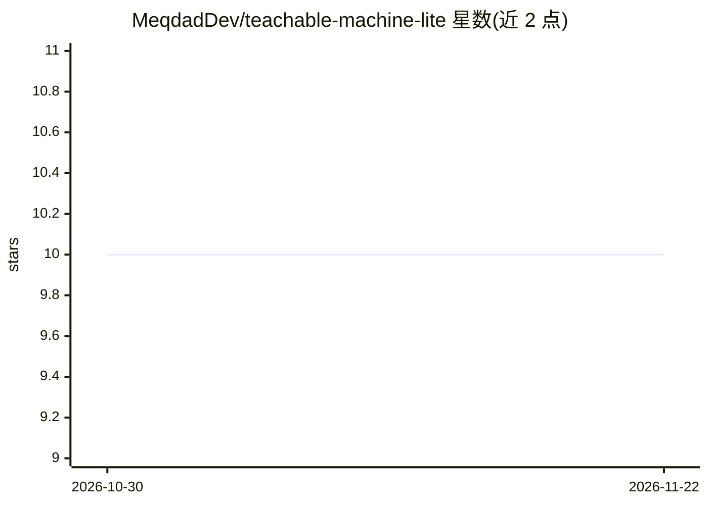

# MeqdadDev/teachable-machine-lite

⭐ 10 · Python · MIT · 推送 2026-10-29 · [GitHub](https://github.com/MeqdadDev/teachable-machine-lite) · [官网](https://meqdaddev.github.io/teachable-machine-lite/) · 个人维护

**在树莓派等边缘设备上运行 Teachable Machine 图像模型**

Python 库：将用户在 Google Teachable Machine 平台导出的 tflite 图像分类模型部署到树莓派、机器人等资源受限设备。基于 LiteRT（原 TensorFlow Lite）推理，无需完整 TensorFlow；输入 OpenCV 或 Picamera2 采集的相机帧，输出预测类别与置信度。支持量化和浮点两种导出格式，要求 Python >= 3.9，树莓派需 64 位系统。

## 筛选速览

| 维度 | 判定 | 备注 |
|---|---|---|
| AI 角色 | `ai-native` | 本体是模型或模型工具 |
| 许可风险 | `permissive` | MIT |
| 部署形态 | `library` | 以包/库形式分发 |
| 模型依赖 | — | README 未给出锁定关系 |
| 硬件要求 | — | 无带数字的原话,不猜 |
| 安装摩擦 | `low` | 无编译、无系统依赖或容器化 |
| 成熟度 | — | 结构信号不足 |

## 能力要点

- 加载 Teachable Machine 导出的 tflite 模型（量化与浮点格式）
- 基于 LiteRT 推理，无需安装完整 TensorFlow
- 接受 OpenCV 或 Picamera2 相机帧，返回类别与置信度
- pip 一行安装，依赖仅 numpy/Pillow/ai-edge-litert

## 适用场景

- 在树莓派上运行自训练的图像分类模型
- 为机器人项目添加相机帧分类能力
- 物联网边缘设备上的轻量级识别任务

## 场景标签

`目标检测` · 领域:感知与多模态

## 证据(README 行号)

> L13: **Run your Google Teachable Machine image models on Raspberry Pi, robots and other edge devices in a few lines of P
> L15: Teachable Machine Lite lets you take an image model you trained in Google's Teachable Machine, with no coding neede

## 星数曲线

2026-10-30 10 → 2026-11-22 10（+0）

---
*卡片 v1 · prompt 1.4 · 生成 2026-11-20 · 置信度 high · 依据 README sha `c147e493a439` · [字段定义](../../DATASET.md)*
