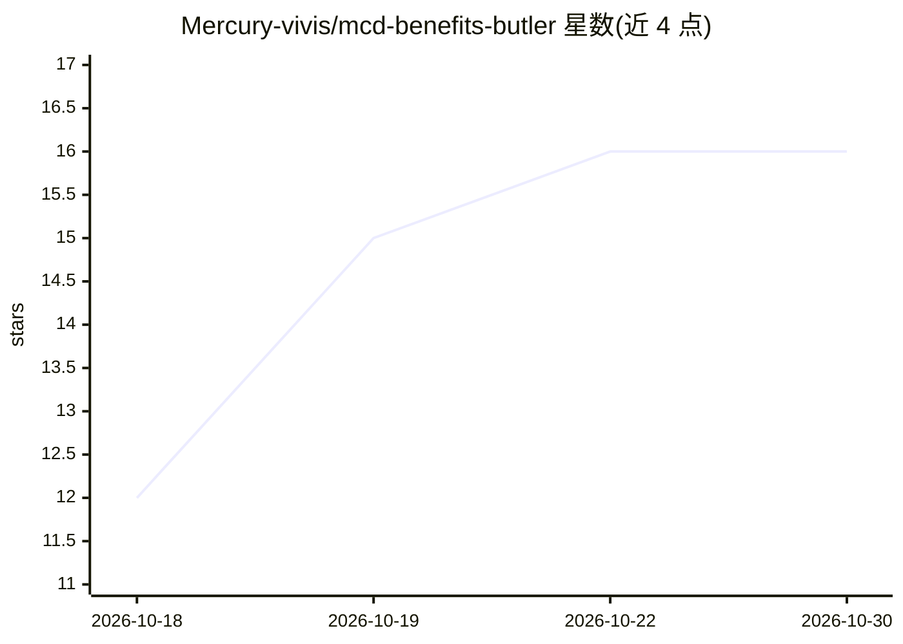

# Mercury-vivis/mcd-benefits-butler

⭐ 16 · Python · MIT · 推送 2026-10-09 · [GitHub](https://github.com/Mercury-vivis/mcd-benefits-butler) · 个人维护 · 中文 README

**扫描麦当劳历史订单待评价权益的 WorkBuddy 技能/MCP 客户端**

基于麦当劳中国官方远程 MCP（mcd-mcp-server）的开源 WorkBuddy Skill 与命令行工具：逐单扫描历史订单，列出尚未评价且奖励券仍可领取的待办清单；同时读取积分账户，按所需积分排序可兑商品并标注过期/临期风险，聚合当月活动、抽奖与可领券信息。Token 仅通过环境变量配置。可通过 WorkBuddy 零安装接入，或以 Python 3.8+ 本地运行。明确不替代官方点餐支付等功能；评价券有领取窗口，错过不可补领，并非每笔订单均附评价邀请。

## 筛选速览

| 维度 | 判定 | 备注 |
|---|---|---|
| AI 角色 | `ai-ecosystem` | LLM/agent 周边工具 |
| 许可风险 | `permissive` | MIT |
| 部署形态 | `None` |  |
| 模型依赖 | — | README 未给出锁定关系 |
| 硬件要求 | — | 无带数字的原话,不猜 |
| 安装摩擦 | `low` | 无编译、无系统依赖或容器化 |
| 成熟度 | — | 结构信号不足 |

## 能力要点

- 逐单扫描历史订单，筛出未评价且奖励券仍可领的待办清单
- 积分按所需数量升序排列并标注过期/临期风险
- 当月活动日历、抽奖、可领券一屏聚合
- 支持 WorkBuddy 零安装接入，Token 仅经环境变量配置

## 适用场景

- 回头翻历史订单，把还来得及评价领券的订单挑出来
- 查看积分能换什么、哪些快过期
- 不用在多个官方入口间来回翻，一屏看当月活动和可领券

## 场景标签

 · 领域:生活服务工具/餐饮权益管理

## 证据(README 行号)

> L7: > 一个基于**麦当劳官方 MCP 能力**（`mcd-mcp-server`）的 WorkBuddy Skill / 开源工具。
> L50: 1. 打开 WorkBuddy → 左侧「连接器」页，找到 **mcd-mcp**（麦当劳官方 MCP）；
> L67: **WorkBuddy 用户**：将本仓库作为 Skill 接入（见 `SKILL.md`），MCP 配置参考 `mcp-config.example.json`，在连接器页对 `mcd-mcp` 点「信任」启用。

## 星数曲线

2026-10-18 12 → 2026-10-30 16（+4）

---
*卡片 v1 · prompt 1.4 · 生成 2026-10-30 · 置信度 mid · 依据 README sha `165cd7f41d45` · [字段定义](../../DATASET.md)*
