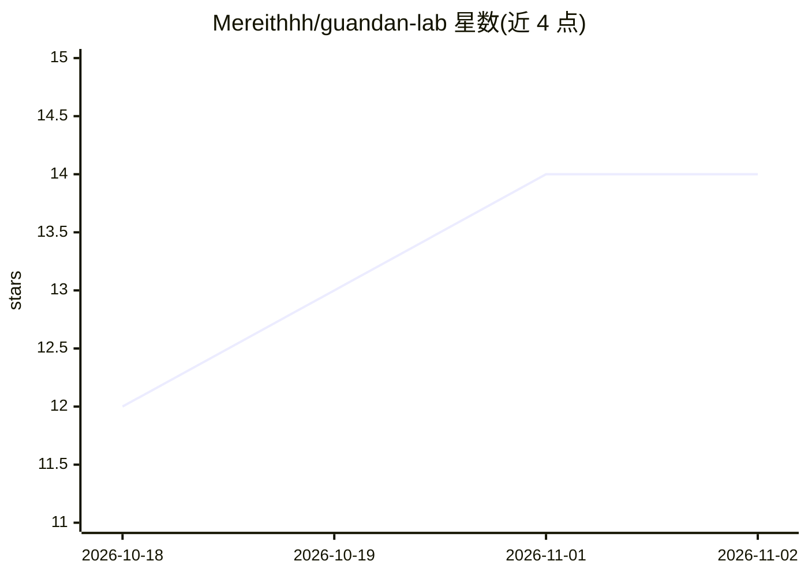

# Mereithhh/guandan-lab

⭐ 14 · TypeScript · Apache-2.0 · 推送 2026-10-31 · [GitHub](https://github.com/Mereithhh/guandan-lab) · [官网](https://guandan.mereith.com) · 个人维护 · 中文 README

**零基础掼蛋训练器：15分钟课程+公平AI陪练+记牌复盘**

面向掼蛋新人的自托管 Web 训练器：以 2022 年竞赛规则为基线，先用标称 15 分钟的 mastery 课程教核心规则，再提供不会偷看牌的本地 AI 整副陪练（三位固定风格 Agent）、已见牌减法与九宫关键牌余量盘等记牌训练、逐手事件回放及牌技/社交分离的赛后建议。可选配置 OpenAI 兼容接口与 ElevenLabs 中文语音教练，未配置密钥时回退到本地规则与设备语音，大模型动作仍经本地合法性校验。数据存 SQLite，支持 Docker 部署与游客云存档。

## 筛选速览

| 维度 | 判定 | 备注 |
|---|---|---|
| AI 角色 | `ai-native` | 本体是模型或模型工具 |
| 许可风险 | `permissive` | Apache-2.0 |
| 部署形态 | `self-host` | docker 或自建部署 |
| 模型依赖 | — | README 未给出锁定关系 |
| 硬件要求 | — | 无带数字的原话,不猜 |
| 安装摩擦 | `low` | 无编译、无系统依赖或容器化 |
| 成熟度 | `idea` | |

## 能力要点

- 三位固定风格本地 Agent 陪练，AI 只见公开信息，动作经规则引擎校验
- 已见牌减法、九宫关键牌余量盘与完整事件回放
- 可选 OpenAI 兼容大模型与 ElevenLabs 语音，均带回退与日预算熔断
- 32 项规则一致性检查与 176 项单元/契约测试

## 适用场景

- 零基础学习掼蛋规则并快速上桌
- 通过记牌训练和复盘提高牌技
- 自托管给朋友提供掼蛋陪练与在线匹配

## 场景标签

 · 领域:游戏/教育

## 证据(README 行号)

> L16: GuanDan Lab 是一个开源的零基础掼蛋训练器。它先用标称 15 分钟的 mastery 课程教授核心规则，再让用户进入不会偷看牌的 AI 整副陪练、记牌训练和逐手复盘。默认场景是陪“王总”上桌：目标是节奏舒服、配合清楚、牌
> L26: - 三位本地 Agent 有可测试的固定风格：王总稳健控场、小顾搭档优先、林姐效率突围；配置兼容 OpenAI 的服务端接口后，大模型会收到相同角色标识，返回动作仍会经过本地合法性校验。
> L54: 打开 `http://localhost:3000`。所有第三方 AI/TTS 配置都是可选项，没有密钥也能完成完整本地训练。

## 星数曲线

2026-10-18 12 → 2026-11-02 14（+2）

---
*卡片 v1 · prompt 1.4 · 生成 2026-11-01 · 置信度 high · 依据 README sha `0253264f6605` · [字段定义](../../DATASET.md)*
