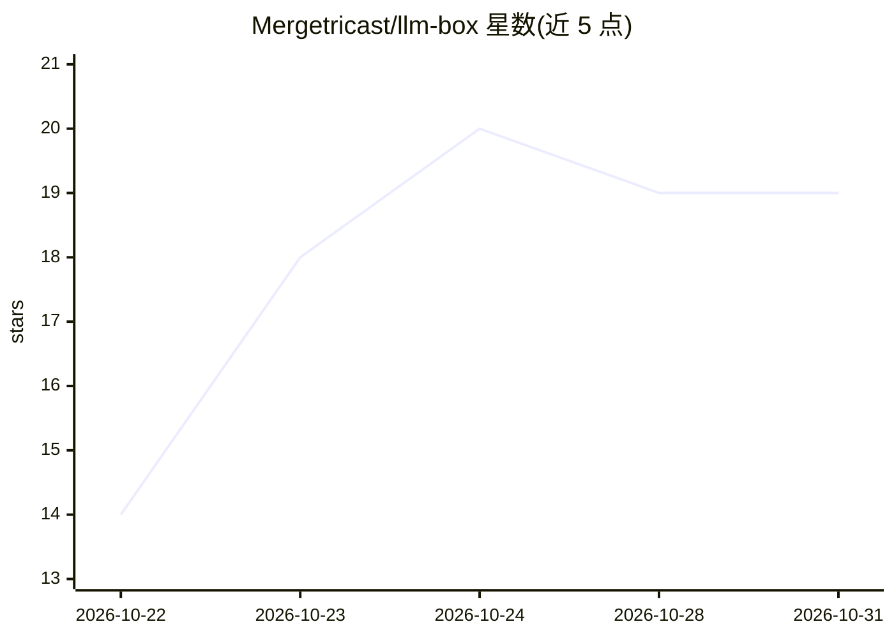

# Mergetricast/llm-box

⭐ 19 · C# · MIT · 推送 2026-10-18 · [GitHub](https://github.com/Mergetricast/llm-box) · 个人维护

**Windows 本地 LLM 服务器管理器：GGUF 一键起 OpenAI 兼容 API**

面向 Windows 10/11 的本地 LLM 服务器管理工具：选择 GGUF 模型后自动检测聊天模板，一键启动 llama.cpp 后端，在 localhost:8080 提供 OpenAI 兼容的 /v1/chat/completions 接口。支持 VRAM 装载校验（超载时警告并建议预设）、托盘热切换模型、按模型保存上下文/线程/GPU 层数等预设、实时日志控制台。发布为约 100 MB 自包含便携 exe，离线运行，MIT 许可并附 SHA-256 校验；源码构建需 .NET 8 SDK。

## 筛选速览

| 维度 | 判定 | 备注 |
|---|---|---|
| AI 角色 | `ai-ecosystem` | LLM/agent 周边工具 |
| 许可风险 | `permissive` | MIT |
| 部署形态 | `None` |  |
| 模型依赖 | local-ok | 支持本地模型 |
| 硬件要求 | — | 无带数字的原话,不猜 |
| 安装摩擦 | `medium` | 含编译或系统依赖之一 |
| 成熟度 | — | 结构信号不足 |

## 能力要点

- GGUF 一键启动并自动检测聊天模板
- OpenAI 兼容 /v1/chat/completions 接口（端口 8080）
- VRAM 装载校验与托盘模型热切换
- 约 100 MB 自包含便携 exe，离线运行，发布附 SHA-256

## 适用场景

- 在 Windows 上快速跑起本地 GGUF 模型的 OpenAI 兼容接口
- 为已有应用提供本地 LLM 端点，无需 Python 或后台服务
- 按模型保存参数预设并在多机间携带

## 场景标签

`推理引擎` · 领域:训练与推理

## 证据(README 行号)

> L3: 🧰 Free, open-source local LLM server manager for Windows — llama.cpp presets, OpenAI-compatible API, VRAM fit checks
> L11: - ✅ **One-click server start** — pick a GGUF, auto-detect chat template, and get a running localhost endpoint in se

## 星数曲线

2026-10-22 14 → 2026-10-31 19（+5）

---
*卡片 v1 · prompt 1.4 · 生成 2026-10-29 · 置信度 high · 依据 README sha `6402933ddc7f` · [字段定义](../../DATASET.md)*
