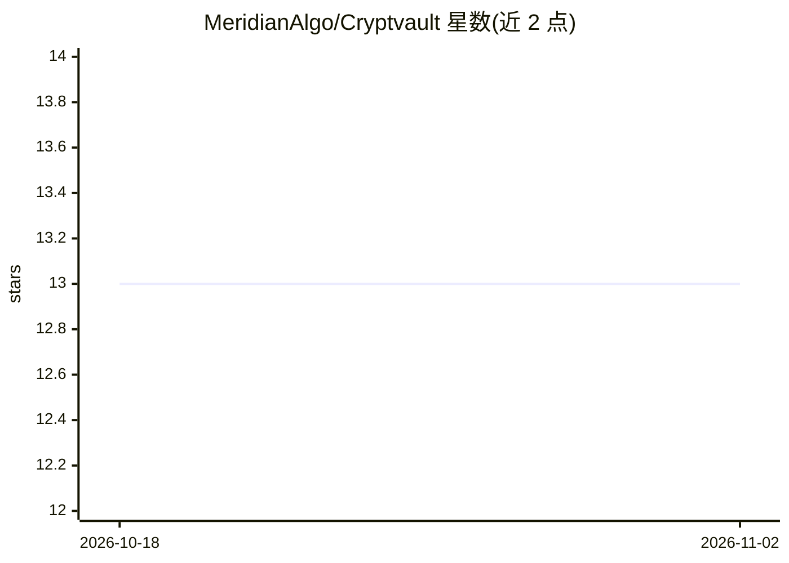

# MeridianAlgo/Cryptvault

⭐ 13 · Python · BSD-3-Clause · 推送 2026-08-03 · [GitHub](https://github.com/MeridianAlgo/Cryptvault) · [官网](https://meridianalgo.github.io/Cryptvault/) · 组织维护

**面向加密货币与股票的 AI/ML 技术分析与预测研究平台**

研究用途的加密货币与股票分析平台，提供桌面终端（trading-vue-js 渲染、Hyperliquid 实时行情、Yahoo 兜底）、CLI 与 Python API 三种形态。功能包括 70+ 经典图表形态识别（全部以几何图形绘制在 K 线图上，含未完成形态投影）、67+ 特征的 ML 集成预测（RF/XGBoost/SVR 等堆叠，报告 MAPE 1.6-2.4%）、DQN/PPO/Transformer 强化学习交易研究组件。README 明确声明仅供教育研究、不得用于实盘交易决策。

## 筛选速览

| 维度 | 判定 | 备注 |
|---|---|---|
| AI 角色 | `ai-native` | 本体是模型或模型工具 |
| 许可风险 | `permissive` | BSD-3-Clause |
| 部署形态 | `library` | 以包/库形式分发 |
| 模型依赖 | — | README 未给出锁定关系 |
| 硬件要求 | — | 无带数字的原话,不猜 |
| 安装摩擦 | `low` | 无编译、无系统依赖或容器化 |
| 成熟度 | — | 结构信号不足 |

## 能力要点

- 70+ 经典图表形态检测并直接绘制于 K 线图（含形成中形态与目标投影）
- ML 集成预测：67+ 工程特征、验证加权堆叠，含可选 XGBoost/LightGBM
- DQN/PPO/Transformer 强化学习交易研究组件
- 桌面终端 + CLI + Python API 三种使用形态

## 适用场景

- 在桌面终端中查看加密货币 K 线与形态标注和预测
- 用 CLI 或 Python API 做技术分析研究与回测
- 用强化学习 agent 做交易策略研究（非实盘）

## 场景标签

`金融量化` `强化学习` · 领域:学习与行业

## 证据(README 行号)

> L25: - A **production ML ensemble** (67+ engineered features, validation-weighted stacking) achieving 1.6-2.4% MAPE on m
> L27: - **Reinforcement-learning agents** (DQN, PPO, Transformer) for trading research.
> L193: **Ensemble** — each base learner weighted by rolling out-of-fold validation:

## 星数曲线

2026-10-18 13 → 2026-11-02 13（+0）

---
*卡片 v1 · prompt 1.4 · 生成 2026-10-31 · 置信度 mid · 依据 README sha `d60e635e385a` · [字段定义](../../DATASET.md)*
