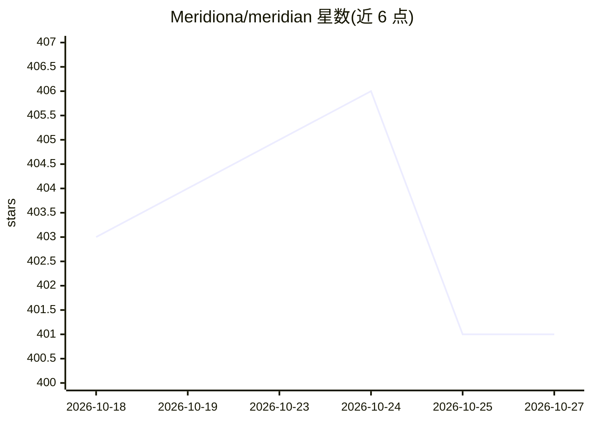

# Meridiona/meridian

⭐ 401 · Rust · NOASSERTION · 推送 2026-10-25 · [GitHub](https://github.com/Meridiona/meridian) · [官网](https://meridiona.com) · 组织维护

**本地优先的自动工作日志桌面应用：记录并总结每日工作**

在 macOS（Apple Silicon）与 Windows 上后台运行的桌面应用：持续捕获屏幕活动并存入本机加密数据库，据此重建每日时间线、生成每日总结与站会汇报草稿，并可自动起草项目工单更新，经确认后发布到 Jira。AI 分析通过用户自行接入的 AI 提供商进行，仅发送摘要所需内容；活动数据保留 30 天后自动清理。提供安装包下载，也可用 Rust/Node/bun 从源码构建；源码采用 PolyForm Strict 许可，仅限个人与非商业用途阅读使用。

## 筛选速览

| 维度 | 判定 | 备注 |
|---|---|---|
| AI 角色 | `ai-enhanced` | 去掉 AI 部分产品仍成立 |
| 许可风险 | `none` | NOASSERTION |
| 部署形态 | `None` |  |
| 模型依赖 | — | README 未给出锁定关系 |
| 硬件要求 | — | 无带数字的原话,不猜 |
| 安装摩擦 | `low` | 无编译、无系统依赖或容器化 |
| 成熟度 | — | 结构信号不足 |

## 能力要点

- 基于屏幕活动自动重建每日时间线与总结
- 自动起草站会汇报与 Jira 工单更新，发布前需人工确认
- 活动数据存储在本机加密数据库，30 天后自动清理
- 支持 macOS（Apple Silicon）与 Windows 10/11，后台运行占用低

## 适用场景

- 我每天想知道时间实际花在了哪里
- 站会前拿到一份根据实际工作生成的汇报草稿
- 回顾几个月前的某天做了什么、工单为何延期

## 场景标签

`AI 助手` `AI 写作` · 领域:对话与助手

## 证据(README 行号)

> L11: See how Meridian turns a day of screen activity into a timeline, a daily summary, and updated tickets, without anyt
> L17: Meridian rebuilds your day from what actually happened on screen, so you can scrub back through it like a recording
> L47: Your activity stays in one encrypted database on your machine. Analysis runs through whichever AI provider you conn

## 星数曲线

2026-10-18 403 → 2026-10-27 401（-2）

---
*卡片 v1 · prompt 1.4 · 生成 2026-10-21 · 置信度 high · 依据 README sha `09c3ca03fb9f` · [字段定义](../../DATASET.md)*
