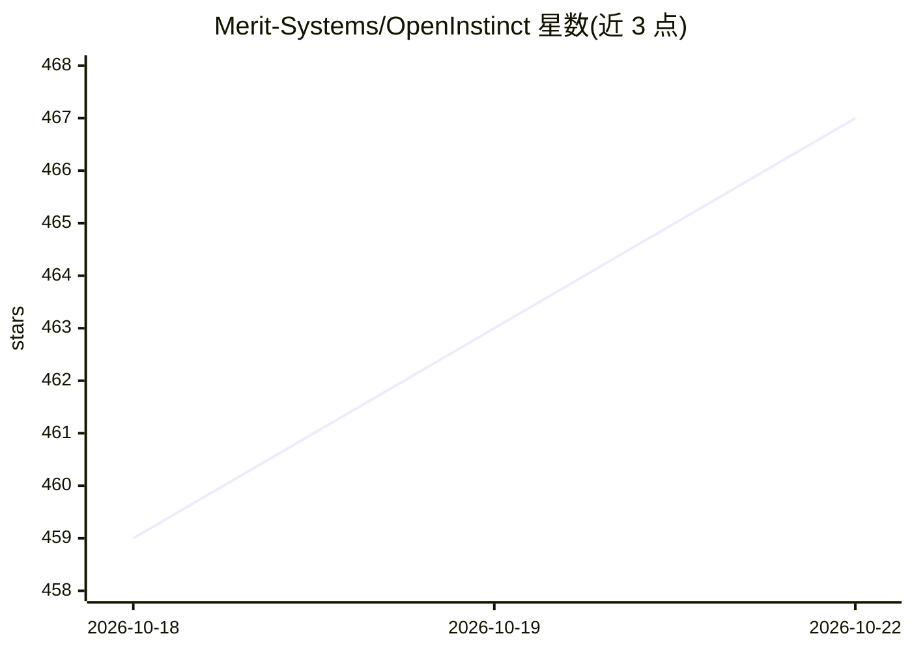

# Merit-Systems/OpenInstinct

⭐ 467 · TypeScript · MIT · 推送 2026-10-05 · [GitHub](https://github.com/Merit-Systems/OpenInstinct) · [官网](https://openinstinct.sh) · 组织维护

**自托管的 iMessage 个人助理：代用户浏览网页办理事务**

部署到用户自己 Vercel 账号的开源个人助理，通过 iMessage 对话接收指令，用云端浏览器（Kernel）代用户执行登录、订票、购物等事务。可接入任意模型（经 Vercel AI Gateway），内置加密密码库（Better Auth 与 vault 加密密钥存私有 Blob），浏览器自动填充使密码不进入模型上下文。可选接入 Google Workspace（Gmail/日历/联系人）与 Stripe Link 钱包（每笔支出需用户批准）。支持每分钟级定时任务，要求 Vercel Pro 计划。

## 筛选速览

| 维度 | 判定 | 备注 |
|---|---|---|
| AI 角色 | `ai-native` | 本体是模型或模型工具 |
| 许可风险 | `permissive` | MIT |
| 部署形态 | `self-host` | docker 或自建部署 |
| 模型依赖 | — | README 未给出锁定关系 |
| 硬件要求 | — | 无带数字的原话,不猜 |
| 安装摩擦 | `low` | 无编译、无系统依赖或容器化 |
| 成熟度 | — | 结构信号不足 |

## 能力要点

- 通过 iMessage 对话驱动的浏览器自动化 agent，可走到结账完成订票/购物
- 密码库密钥独立生成并加密存储，自动填充密码不进入模型上下文
- 可选 Google Workspace 接入与 Stripe Link 钱包支付（每笔需用户批准）
- 每用户持久记忆与 workstreams 记录（每作用域上限 100 条，容量满时询问淘汰）

## 适用场景

- 通过 iMessage 让助理代订电影票或处理日常事务
- 自托管控制自己的密码、信用卡与对话上下文
- 让助理代查 Gmail、日历并代为发起购买（需我批准）

## 场景标签

`浏览器自动化` `AI 助手` · 领域:效率与自动化

## 证据(README 行号)

> L3: **A personal iMessage assistant that can use a browser like you.**
> L8: It's open source, self-hostable, and can use any model.
> L22: on your behalf. OpenInstinct runs in your own Vercel account. Saved vault secrets

## 星数曲线

2026-10-18 459 → 2026-10-22 467（+8）

---
*卡片 v1 · prompt 1.4 · 生成 2026-10-21 · 置信度 mid · 依据 README sha `c8933da3e3d1` · [字段定义](../../DATASET.md)*
