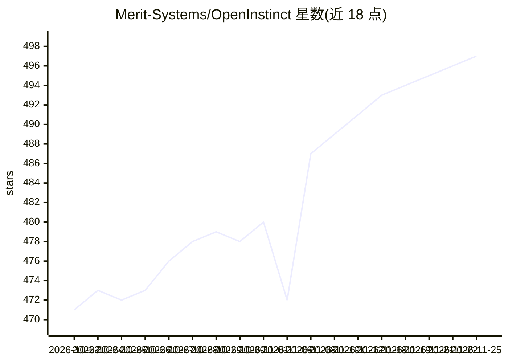

# Merit-Systems/OpenInstinct

⭐ 497 · TypeScript · MIT · 推送 2026-11-02 · [GitHub](https://github.com/Merit-Systems/OpenInstinct) · [官网](https://openinstinct.sh) · 组织维护

**自托管的 iMessage 个人助理：代订票、代购物、管密码**

部署到用户自己 Vercel 账户的 iMessage 个人助理：通过云端浏览器以用户身份完成订电影票、下单买菜等事务。密码、信用卡等机密入库前加密，浏览器自动填充使密码不进入模型上下文；数据库持久化每用户记忆与 workstream（目标/决策/待办，限 100 条/工作区）。依赖 Vercel Pro（分钟级 cron）、Kernel 云浏览器、Neon Postgres、Linq iMessage 连接器与 AI Gateway；可选 Google Workspace（Gmail/日历/联系人）与 Stripe Link 钱包（当前购买功能暂禁用）。

## 筛选速览

| 维度 | 判定 | 备注 |
|---|---|---|
| AI 角色 | `ai-native` | 本体是模型或模型工具 |
| 许可风险 | `permissive` | MIT |
| 部署形态 | `self-host` | docker 或自建部署 |
| 模型依赖 | — | README 未给出锁定关系 |
| 硬件要求 | — | 无带数字的原话,不猜 |
| 安装摩擦 | `low` | 无编译、无系统依赖或容器化 |
| 成熟度 | — | 结构信号不足 |

## 能力要点

- 浏览器代操作：示例演示走完 Fandango 购票结账并回报座位与总价
- 密码保管库加密入库，自动填充避免密码进入模型上下文
- workstream 记忆：跨会话回忆目标、决策与未完成步骤，容量淘汰需用户确认
- 支持任意模型（经 Vercel AI Gateway），一键部署到自己的 Vercel 账户

## 适用场景

- 通过 iMessage 让助理代订电影票并确认座位场次
- 把跑腿类网络事务（下单购物、预约）交给代办 agent
- 自托管个人助理并掌控自己的密码与支付授权

## 场景标签

`AI 助手` `浏览器自动化` `Agent 记忆` · 领域:Agent 开发

## 证据(README 行号)

> L3: **A personal iMessage assistant that can use a browser like you.**
> L5: It can do your chores, book movie tickets, or handle your groceries.
> L8: It's open source, self-hostable, and can use any model.

## 星数曲线

2026-10-23 471 → 2026-11-25 497（+26）

---
*卡片 v1 · prompt 1.4 · 生成 2026-11-25 · 置信度 high · 依据 README sha `28845c918a1f` · [字段定义](../../DATASET.md)*
