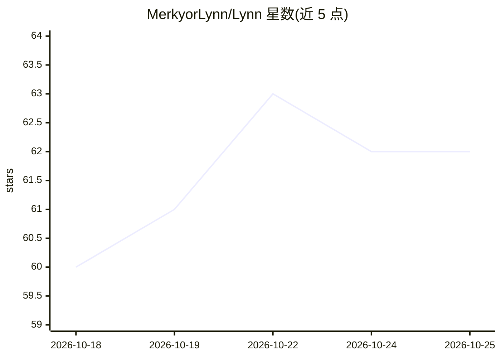

# MerkyorLynn/Lynn

⭐ 62 · TypeScript · Apache-2.0 · 推送 2026-10-24 · [GitHub](https://github.com/MerkyorLynn/Lynn) · [官网](https://download.merkyorlynn.com/download.html) · 个人维护 · 中文 README

**开源桌面 AI Agent 与 CLI：对话任务、实时语音、本地模型**

Lynn 是同时提供 Electron 桌面 GUI 与独立 CLI 的开源 AI Agent，面向终端用户的对话、搜索、文件处理、代码任务与实时语音，也可作为 Codex / Claude Code 等其他 Agent 或 CI 的无头 worker（输出 JSON/JSONL）。默认工作模型为云端 Step 5 Preview，语音由 StepAudio 2.5 Realtime 承接；本地方案为 Qwen3.8-27B Coder390 EfficientThink 的 llama.cpp GGUF Q2/Q3（要求 16GB/24GB 显存或 Apple 统一内存）。CLI 经 npm 一行安装，Windows 安装包内置 llama.cpp 运行时。

## 筛选速览

| 维度 | 判定 | 备注 |
|---|---|---|
| AI 角色 | `ai-native` | 本体是模型或模型工具 |
| 许可风险 | `permissive` | Apache-2.0 |
| 部署形态 | `desktop` | 安装包/桌面程序 |
| 模型依赖 | local-ok | 支持本地模型 |
| 硬件要求 | — | 无带数字的原话,不猜 |
| 安装摩擦 | `low` | 无编译、无系统依赖或容器化 |
| 成熟度 | — | 结构信号不足 |

## 能力要点

- GUI 桌面助手 + 可作无头 worker 的 CLI，共享模型与工具链
- 实时语音对话（StepAudio 2.5 Realtime，GUI 麦克风与 CLI /voice）
- 本地 Coder390 Q2/Q3 GGUF（llama.cpp，内置 Q4 MTP），按显存分档校验安装
- Fleet 模式可把任务派给 Codex / Claude Code / Kimi 等外部 worker 并统一输出 JSONL

## 适用场景

- 在桌面端用对话完成搜索、文件处理与代码任务并确认每处改动
- 把 Lynn CLI 当作终端 TUI 或 CI / 其他 Agent 的后台 worker
- 在 16GB+ 显存或 Apple Silicon 设备上本地运行代码任务模型

## 场景标签

`AI 助手` `编码 Agent` `语音 Agent` · 领域:编码与开发

## 证据(README 行号)

> L22: Lynn 是同时提供桌面 GUI 与独立 CLI 的开源 AI Agent：用对话完成搜索、文件处理、代码任务和实时语音，也可以作为其他 Agent 或 CI 的无头 worker。**当前 GUI / CLI 均为 V0.87.
> L30: |默认对话、编码与工具任务|**Step 5 Preview**（`step-5-preview`）|GUI / CLI 默认由 Brain 托管|
> L33: |本地文本与代码任务|**Qwen3.8-27B Coder390 EfficientThink**|设置中明确选择、安装、启动 llama.cpp Q2 / Q3|

## 星数曲线

2026-10-18 60 → 2026-10-25 62（+2）

---
*卡片 v1 · prompt 1.4 · 生成 2026-10-24 · 置信度 high · 依据 README sha `292f69dc59f1` · [字段定义](../../DATASET.md)*
