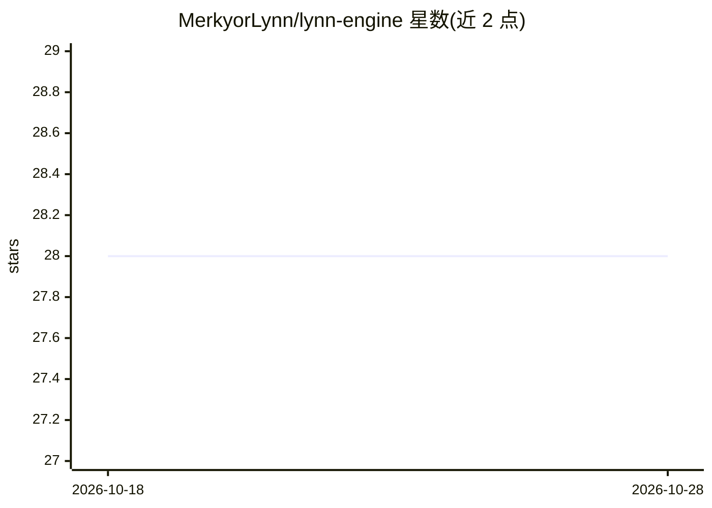

# MerkyorLynn/lynn-engine

⭐ 28 · Python · 推送 2026-06-08 · [GitHub](https://github.com/MerkyorLynn/lynn-engine) · 个人维护 · 中文 README

**面向 NVIDIA Blackwell 的自研 LLM 推理引擎（已收口归档）**

从零编写的 27B/35B 级单模型 LLM 推理引擎，锁定 variable-pruned MoE 与 NVFP4/W4A8 量化格式，自写 CUDA/Triton 内核，支持投机解码（MTP）、显存 shadow 释放（decode 常驻 88→28 GiB）与 OpenAI HTTP 服务端。README 顶部宣布 2026-06-07 引擎线收口：单流推理结论为采用 llama.cpp，并发服务采用 vLLM+NVFP4，自研内核成果以 4 个上游 PR（llama.cpp 1 个、vLLM 3 个）回馈生态，本仓库转为研究资产与证据账本归档。

## 筛选速览

| 维度 | 判定 | 备注 |
|---|---|---|
| AI 角色 | `ai-ecosystem` | LLM/agent 周边工具 |
| 许可风险 | `none` | — |
| 部署形态 | `None` |  |
| 模型依赖 | — | README 未给出锁定关系 |
| 硬件要求 | `gpu-24g` | |
| 安装摩擦 | `medium` | 含编译或系统依赖之一 |
| 成熟度 | — | 结构信号不足 |

## 能力要点

- 自写 CUDA/Triton 内核的 NVFP4/W4A16 MoE 推理路径
- decode-only 删 shadow 权重，常驻显存 88→28 GiB（TPS 0.998× 无回归）
- MTP/APEX 投机解码路径，单流 77 tok/s（llama.cpp 后端）
- 成果回馈上游：llama.cpp #24273 与 vLLM 3 个 NVFP4 PR

## 适用场景

- 研究 NVFP4 量化在 MoE 推理中的显存与吞吐表现
- 复核算子融合与 launch 开销优化的实验证据
- 了解自研引擎与 llama.cpp/vLLM 的实测对比结论

## 场景标签

`推理引擎` · 领域:训练与推理

## 证据(README 行号)

> L101: > **为 NVIDIA Blackwell 写的 Lynn 27B-A3B NVFP4 单模型推理引擎。**
> L102: > 从零写,锁定 Lynn 自家的 variable-pruned MoE + NVFP4 格式,目标很窄也很硬:Spark 负责 35B 服务/内存/runtime 证据,R6000-class FP4-MMA 硬件负责 na
> L117: **6/3 战略校正(取代 5/20 pivot)**:Lynn engine **重启为并行主线,目标对标 llama.cpp** —— 不再是"降级为 R&D / 客户端投奔 llama.cpp"。客户端短期仍以 llama

## 星数曲线

2026-10-18 28 → 2026-10-28 28（+0）

---
*卡片 v1 · prompt 1.4 · 生成 2026-10-26 · 置信度 high · 依据 README sha `666777d0222e` · [字段定义](../../DATASET.md)*
