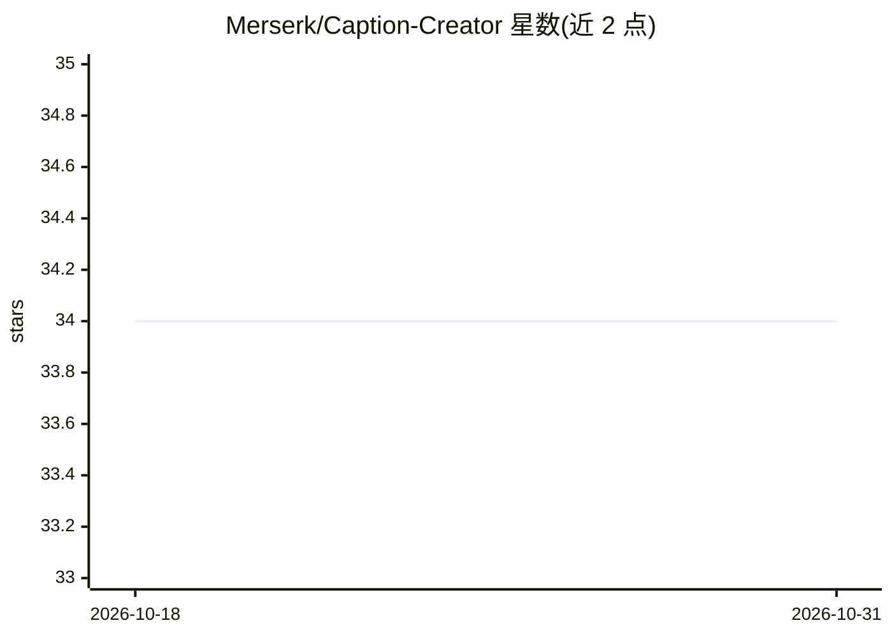

# Merserk/Caption-Creator

⭐ 34 · JavaScript · MIT · 推送 2026-08-20 · [GitHub](https://github.com/Merserk/Caption-Creator) · 个人维护

**Windows 桌面应用：本地生成图像打标与描述，用于数据集制作**

便携式 Windows 桌面应用，从图像生成 Captions、Tags、JSON、YAML、Illustrious 提示词或自定义格式输出，面向图像数据集制作、LoRA 训练与 AI 提示场景。本地优先：内置 GGUF 视觉模型（按 VRAM 分档下载），或通过 LM Studio / Ollama 接入自有视觉模型，图像不出本机。支持单图与批处理队列、模型管理（下载/删除/加载）、触发词与提示词增强、低显存模式、ZIP 导出等。以可下载的 exe 便携包形式分发，MIT 许可。

## 筛选速览

| 维度 | 判定 | 备注 |
|---|---|---|
| AI 角色 | `ai-native` | 本体是模型或模型工具 |
| 许可风险 | `permissive` | MIT |
| 部署形态 | `desktop` | 安装包/桌面程序 |
| 模型依赖 | local-ok | 支持本地模型 |
| 硬件要求 | `gpu-8g` | |
| 安装摩擦 | `low` | 无编译、无系统依赖或容器化 |
| 成熟度 | — | 结构信号不足 |

## 能力要点

- 内置 GGUF 视觉模型本地生成，或接入 LM Studio / Ollama 模型
- 多输出类型：Captions/Tags/JSON/YAML/Illustrious/自定义
- 单图与批量处理、任务队列、ZIP 导出
- 模型按 VRAM 分档（6GB–12GB），含低显存模式

## 适用场景

- 为 LoRA 训练批量生成图像打标和描述
- 为图像生成模型整理 Illustrious 提示词数据集
- 本地离线批量为图片文件夹生成标签

## 场景标签

 · 领域:图像标注/数据集工具

## 证据(README 行号)

> L10: **Caption Creator** is a portable Windows app for generating high-quality text from images. Create captions, tags, 
> L16: Run everything locally with built-in GGUF models, or connect your own vision model through **LM Studio** or **Ollam

## 星数曲线

2026-10-18 34 → 2026-10-31 34（+0）

---
*卡片 v1 · prompt 1.4 · 生成 2026-10-25 · 置信度 high · 依据 README sha `0e4aaecb85ae` · [字段定义](../../DATASET.md)*
