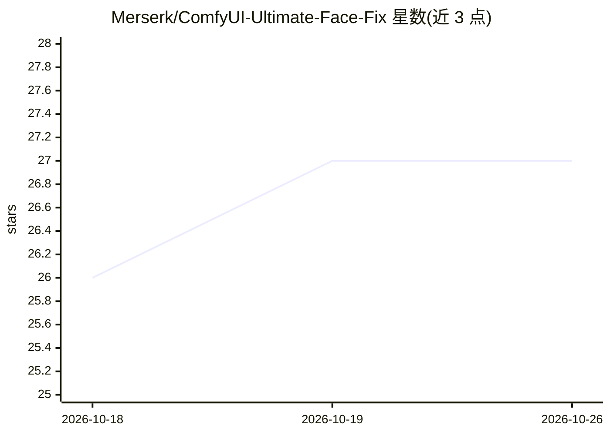

# Merserk/ComfyUI-Ultimate-Face-Fix

⭐ 27 · Python · AGPL-3.0 · 推送 2026-07-21 · [GitHub](https://github.com/Merserk/ComfyUI-Ultimate-Face-Fix) · 个人维护

**ComfyUI 人脸修复节点：检测裁剪人脸后用生成模型修复并回贴**

面向 ComfyUI 用户的自定义节点集：检测单张或多张人脸，对每个方形裁剪区域用已连接的生成模型（SD 1.5/SDXL/FLUX/Pony 等 20 余种 checkpoint）做 img2img 修复，构建 SegFace 语义掩码、颜色匹配与无缝混合，仅将脸部区域贴回原图。提供六个扩展节点，支持 Extract/Process 分离式自定义裁剪管线、自动去噪推荐与外部 bbox/MediaPipe/SAM 可选连接。通过 ComfyUI Manager 或 git clone 手动安装。

## 筛选速览

| 维度 | 判定 | 备注 |
|---|---|---|
| AI 角色 | `ai-ecosystem` | LLM/agent 周边工具 |
| 许可风险 | `viral` | AGPL-3.0 |
| 部署形态 | `library` | 以包/库形式分发 |
| 模型依赖 | — | README 未给出锁定关系 |
| 硬件要求 | — | 无带数字的原话,不猜 |
| 安装摩擦 | `low` | 无编译、无系统依赖或容器化 |
| 成熟度 | — | 结构信号不足 |

## 能力要点

- 检测-裁剪-img2img 修复-语义掩码混合的单/多人脸修复流程
- 支持 SD 1.5 到 FLUX.2、Qwen-Image 等 20 余种生成模型 checkpoint
- Extract/Process 分离节点支持自定义裁剪放大与增强管线
- Auto Denoise 根据人脸尺寸给出去噪强度推荐

## 适用场景

- 修复 AI 生成或现有图片中损坏、模糊的人脸
- 对写实、动漫、插画类图像做多人脸批量修复
- 在裁剪管线中插入自己的放大或增强节点后再回贴

## 场景标签

`图像视频处理` · 领域:感知与多模态

## 证据(README 行号)

> L3: Model-aware face repair for one or many faces. It detects faces, repairs each square crop with your connected genera
> L15: In **ComfyUI Manager**, search for **Ultimate Face Fix** and select **Install**. Manager installs the Python depend
> L27: All six extension nodes are under **Add Node → ultimate face fix**. For the integrated workflow, add the detector l

## 星数曲线

2026-10-18 26 → 2026-10-26 27（+1）

---
*卡片 v1 · prompt 1.4 · 生成 2026-10-26 · 置信度 mid · 依据 README sha `7ada5f010434` · [字段定义](../../DATASET.md)*
