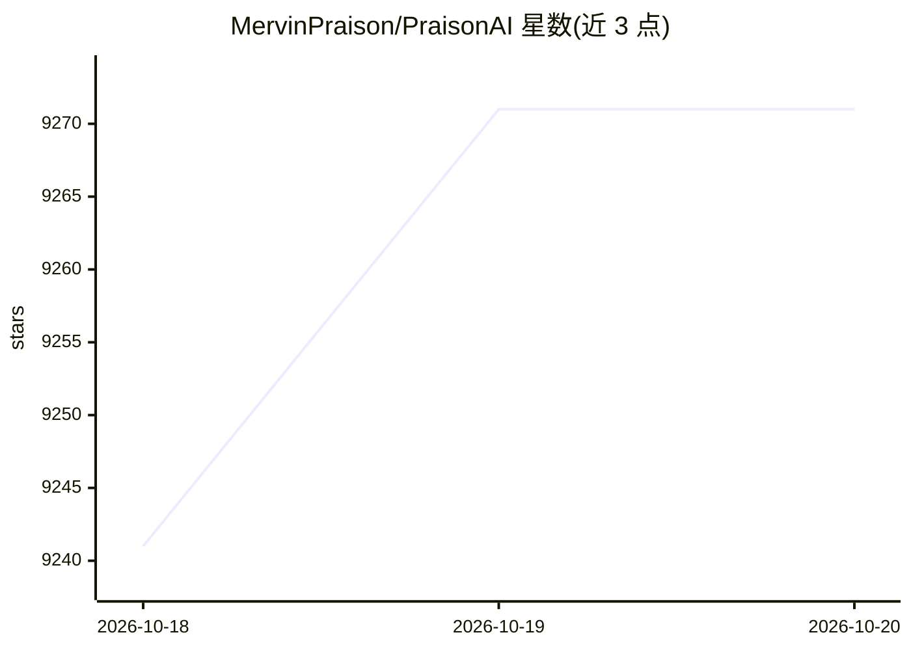

# MervinPraison/PraisonAI

⭐ 9,271 · Python · MIT · 推送 2026-10-19 · [GitHub](https://github.com/MervinPraison/PraisonAI) · [官网](https://praison.ai/docs) · 个人维护

**开发者用的多智能体框架：5 行代码构建和运行 AI Agent**

面向 Python/JS 开发者的开源 AI agent 框架与 SDK，提供单 Agent、多 Agent 编排、AgentFlow 工作流（route/parallel/loop/repeat）、MCP 工具接入、记忆与 RAG、guardrails、沙箱执行等能力，宣称支持 100+ LLM（OpenAI、Anthropic、Gemini、Ollama 等 24 家，附接入示例）。以五层结构组织（Prompt/Context/Harness/Loop/Graph），核心包 praisonaiagents 经 pip 安装，另有 CLI、可视化构建器、UI 等扩展；Agent 可将工具或整体运行于 Docker 等托管沙箱。提供 macOS/Windows/Linux 桌面安装包。

## 筛选速览

| 维度 | 判定 | 备注 |
|---|---|---|
| AI 角色 | `ai-ecosystem` | LLM/agent 周边工具 |
| 许可风险 | `permissive` | MIT |
| 部署形态 | `library` | 以包/库形式分发 |
| 模型依赖 | local-ok | 支持本地模型 |
| 硬件要求 | — | 无带数字的原话,不猜 |
| 安装摩擦 | `low` | 无编译、无系统依赖或容器化 |
| 成熟度 | — | 结构信号不足 |

## 能力要点

- 五层 Agent 栈：Prompt/Context/Harness/Loop/Graph，工作流可写成 YAML
- MCP 协议接入（stdio/HTTP/WebSocket/SSE）与外部 Agent 编排（Claude Code、Gemini CLI、Codex）
- 支持 24 家 LLM 提供商并附接入示例，含 Ollama、vLLM 本地运行时
- 沙箱执行、doom-loop 检测、记忆、RAG、guardrails 内置

## 适用场景

- 用少量代码构建研究、编码、内容创作等多智能体应用
- 把 Agent 接入 Telegram/Slack/Discord 做客服机器人
- 在 Docker 沙箱中隔离运行 Agent 工具与工作流

## 场景标签

`Agent 框架` `多智能体` · 领域:Agent 开发

## 证据(README 行号)

> L238: * **Core SDK (`praisonaiagents`)**: For pure Python development. `pip install praisonaiagents`
> L91: |Layer|The question it answers|PraisonAI|
> L252: Powered by 100+ LLMs (OpenAI, Anthropic, Gemini & local models).

## 星数曲线

2026-10-18 9,241 → 2026-10-20 9,271（+30）

---
*卡片 v1 · prompt 1.4 · 生成 2026-10-20 · 置信度 high · 依据 README sha `f251fae6839e` · [字段定义](../../DATASET.md)*
