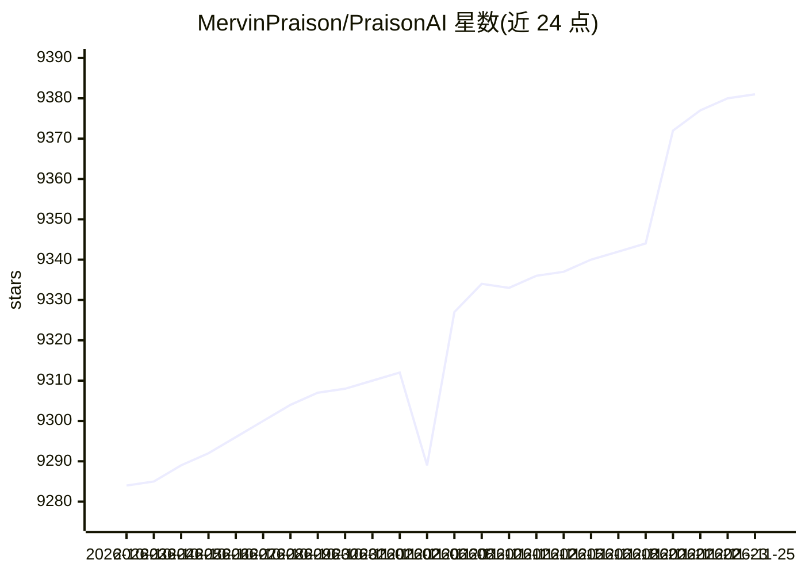

# MervinPraison/PraisonAI

⭐ 9,381 · Python · MIT · 推送 2026-11-23 · [GitHub](https://github.com/MervinPraison/PraisonAI) · [官网](https://praison.ai) · 组织维护

**可完全离线运行的 Python 多智能体框架**

Python agent 框架，提供 teams、workflows、memory、tools 等能力，支持通过 Ollama/vLLM/LM Studio 等在本地模型上运行而无需 API key，提示与回答保留在本机。组件包括 Agents 核心库、接入 Telegram/Discord/Slack/WhatsApp 的 Bot 网关、终端编码 Agent、MCP 双向集成（serve 85 个工具给 Cursor/Claude Desktop 等 22 个客户端）、在自有 GPU 上微调开源模型的 Train，以及面向受监管团队的 Private AI 交接流程（Watch/Test/Hand over/Roll back/Record）。MIT 许可，pip 安装。

## 筛选速览

| 维度 | 判定 | 备注 |
|---|---|---|
| AI 角色 | `ai-ecosystem` | LLM/agent 周边工具 |
| 许可风险 | `permissive` | MIT |
| 部署形态 | `library` | 以包/库形式分发 |
| 模型依赖 | local-ok | 支持本地模型 |
| 硬件要求 | — | 无带数字的原话,不猜 |
| 安装摩擦 | `low` | 无编译、无系统依赖或容器化 |
| 成熟度 | `idea` | |

## 能力要点

- 五层 Agent 栈（Prompt/Context/Harness/Loop/Graph）与 Managed Agents 沙箱（Docker/E2B/Modal）
- 完全离线运行：Ollama 本地模型无需 API key
- MCP 双向支持：使用任意 MCP 服务器，并向 22 个客户端提供 85 个工具
- Bot 网关支持 10 个通道，含流式、语音、审批与重试

## 适用场景

- 在无网络/隔离环境中运行 AI agent
- 为受监管行业构建可审计的私有 AI 交接流程
- 把 agent 部署到 Telegram/Slack 等聊天渠道
- 用 YAML 无代码方式定义 agent 工作流

## 场景标签

`Agent 框架` `多智能体` `微调` · 领域:Agent 开发

## 证据(README 行号)

> L9: **AI agents that run on your own computers, even fully offline.**
> L19:  Python agent framework: teams, workflows, memory, tools.
> L113:  Memory and RAG Memory, knowledge and sessions, with zero extra deps to start.

## 星数曲线

2026-10-23 9,284 → 2026-11-25 9,381（+97）

---
*卡片 v1 · prompt 1.4 · 生成 2026-11-25 · 置信度 mid · 依据 README sha `9bc91f2764b1` · [字段定义](../../DATASET.md)*
