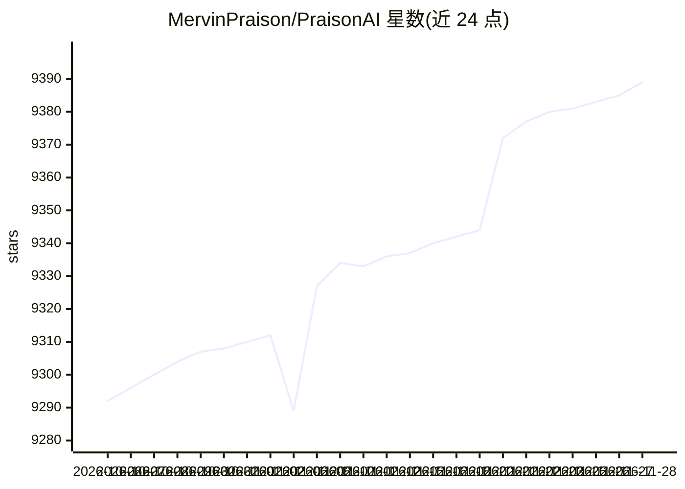

# MervinPraison/PraisonAI

⭐ 9,389 · Python · MIT · 推送 2026-11-27 · [GitHub](https://github.com/MervinPraison/PraisonAI) · [官网](https://praison.ai) · 个人维护

**可完全离线运行的 Python 多智能体框架**

PraisonAI 是一个 Python 智能体框架，提供 teams、workflows、memory、tools 等核心能力，并按模块拆分为 Agents、Bot（Telegram/Discord/Slack/WhatsApp 接入）、Code（终端编码智能体）、MCP、Train（微调）等安装包。支持通过 Ollama/vLLM/LM Studio 运行本地模型，无需 API key。提出五层智能体栈（Prompt/Context/Harness/Loop/Graph）与 Managed Agents 沙箱执行机制，支持 Docker/E2B/Modal 等运行位置，并提供 YAML 无代码定义流程。面向需要本地化、可审计运行的团队。

## 筛选速览

| 维度 | 判定 | 备注 |
|---|---|---|
| AI 角色 | `ai-ecosystem` | LLM/agent 周边工具 |
| 许可风险 | `permissive` | MIT |
| 部署形态 | `library` | 以包/库形式分发 |
| 模型依赖 | local-ok | 支持本地模型 |
| 硬件要求 | — | 无带数字的原话,不猜 |
| 安装摩擦 | `low` | 无编译、无系统依赖或容器化 |
| 成熟度 | `idea` | |

## 能力要点

- 支持本地模型完全离线运行（Ollama/vLLM/LM Studio），无需 API key
- 五层智能体栈与 doom-loop 检测（默认开启）
- MCP 双向支持：智能体调用 MCP 服务器，也可接入 Cursor 等 MCP 客户端
- Bot 网关接入 10 个消息渠道，带审批、限流与会话管理

## 适用场景

- 在无网络/隔离环境中运行本地 LLM 智能体
- 构建多智能体协作流程（路由、并行、循环、交接）
- 将智能体接入 Telegram/Discord/Slack 等 10 个渠道
- 在 Cursor 等 MCP 客户端中使用自己的智能体工具

## 场景标签

`Agent 框架` `多智能体` `编码 Agent` `微调` · 领域:Agent 开发

## 证据(README 行号)

> L19:  Python agent framework: teams, workflows, memory, tools.
> L112:  Multi-agent teams Handoffs, route, parallel, loop and repeat.

## 星数曲线

2026-10-26 9,292 → 2026-11-28 9,389（+97）

---
*卡片 v1 · prompt 1.4 · 生成 2026-11-28 · 置信度 mid · 依据 README sha `d01750505d18` · [字段定义](../../DATASET.md)*
