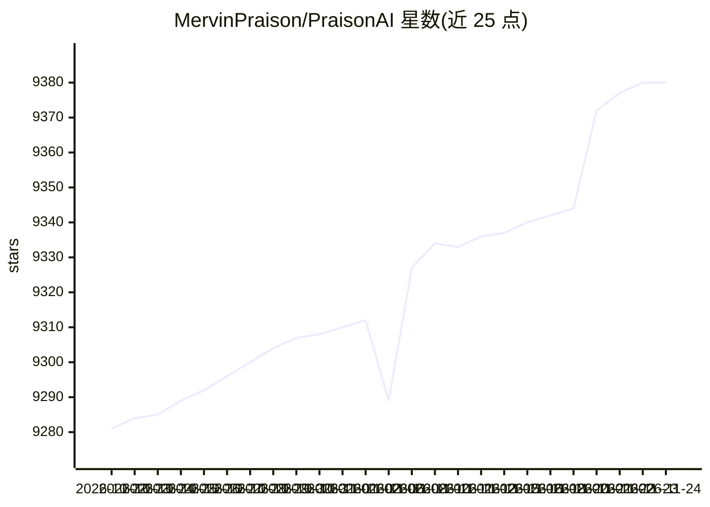

# MervinPraison/PraisonAI

⭐ 9,380 · Python · MIT · 推送 2026-11-22 · [GitHub](https://github.com/MervinPraison/PraisonAI) · [官网](https://praison.ai) · 组织维护

**可完全离线运行的 Python 多智能体开发框架**

PraisonAI 是一个开源 Python 智能体框架，提供 teams、workflows、memory、tools 等能力，可在本地模型上完全离线运行（README 给出 Ollama + Llama 3.2 且无 API key 的运行示例）。组件包括核心库 praisonaiagents、Bot（Telegram/Discord/Slack/WhatsApp）、终端编码 agent、MCP 集成、微调工具与仪表盘；支持 YAML 无代码定义工作流、Docker/E2B/Modal 沙箱执行、五层架构与 doom-loop 检测。MIT 许可；面向监管严格团队 Private AI 交接功能处于 early access。

## 筛选速览

| 维度 | 判定 | 备注 |
|---|---|---|
| AI 角色 | `ai-ecosystem` | LLM/agent 周边工具 |
| 许可风险 | `permissive` | MIT |
| 部署形态 | `library` | 以包/库形式分发 |
| 模型依赖 | local-ok | 支持本地模型 |
| 硬件要求 | — | 无带数字的原话,不猜 |
| 安装摩擦 | `low` | 无编译、无系统依赖或容器化 |
| 成熟度 | `idea` | |

## 能力要点

- 支持通过 Ollama/vLLM/LM Studio 在本地模型上完全离线运行，无需 API key
- 五层智能体栈（Prompt/Context/Harness/Loop/Graph）与 doom-loop 默认检测
- 提供 Bot、编码 agent、MCP、微调、仪表盘等多个子包，pip/npm 安装
- 工具可在 Docker、E2B、Modal 沙箱中运行，支持 YAML 无代码定义

## 适用场景

- 在无网络的本地机器上运行 AI agent 处理数据
- 为 Telegram/Discord/Slack/WhatsApp 部署带记忆的机器人
- 在终端里让 agent 读写本地代码
- 在自有 GPU 上基于历史任务微调开源模型

## 场景标签

`Agent 框架` `多智能体` `微调` · 领域:Agent 开发

## 证据(README 行号)

> L18:  Python agent framework: teams, workflows, memory, tools.
> L71: Run the same agent on a model on your own computer with Ollama. You need no API key, and your prompts and answers s
> L107:  Multi-agent teams Handoffs, route, parallel, loop and repeat.

## 星数曲线

2026-10-22 9,281 → 2026-11-24 9,380（+99）

---
*卡片 v1 · prompt 1.4 · 生成 2026-11-23 · 置信度 high · 依据 README sha `3fec966fe57a` · [字段定义](../../DATASET.md)*
