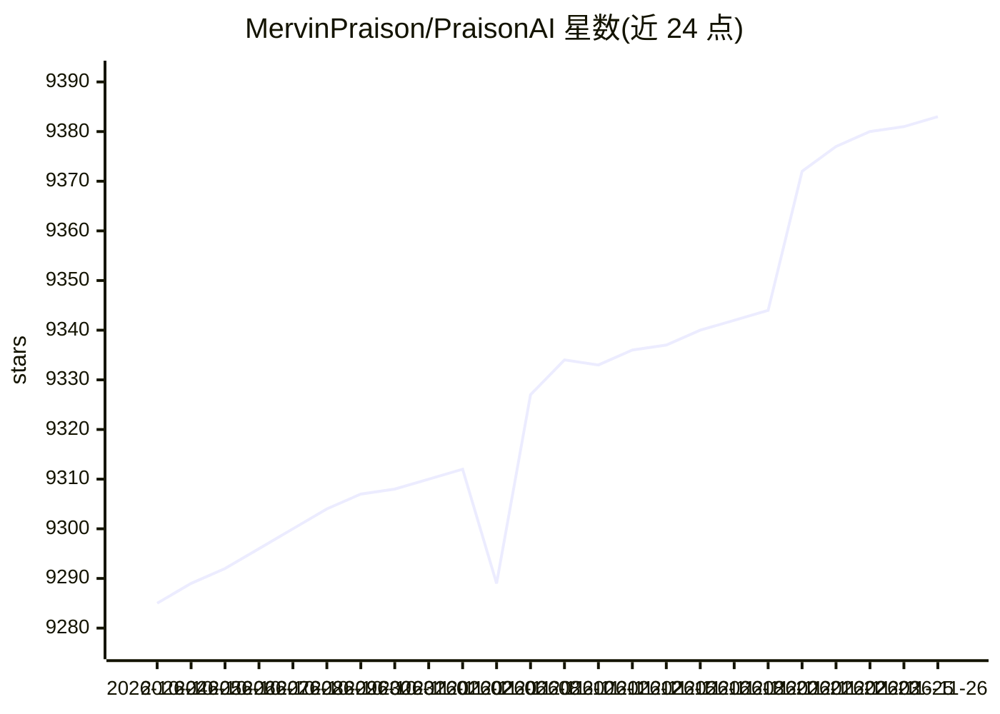

# MervinPraison/PraisonAI

⭐ 9,383 · Python · MIT · 推送 2026-11-25 · [GitHub](https://github.com/MervinPraison/PraisonAI) · [官网](https://praison.ai) · 组织维护

**可完全离线运行的 Python 多智能体框架，面向数据敏感团队**

Python 编写的开源（MIT）agent 框架，围绕 Agent、AgentFlow、AgentTeam 提供五层结构：Prompt、Context、Harness、Loop、Graph，外加 Managed Agents 沙箱层（Docker/E2B/Modal）。组件拆分为多个包：核心 praisonaiagents、Bot 网关（10 个消息渠道）、Code 终端编码 agent、MCP 桥接、Train 微调。支持通过 Ollama/vLLM/LM Studio 接本地模型实现无 API key 的完全离线运行；另含面向银行、保险、医院的 Private AI 渐进移交机制（early access）。

## 筛选速览

| 维度 | 判定 | 备注 |
|---|---|---|
| AI 角色 | `ai-ecosystem` | LLM/agent 周边工具 |
| 许可风险 | `permissive` | MIT |
| 部署形态 | `library` | 以包/库形式分发 |
| 模型依赖 | local-ok | 支持本地模型 |
| 硬件要求 | — | 无带数字的原话,不猜 |
| 安装摩擦 | `low` | 无编译、无系统依赖或容器化 |
| 成熟度 | `idea` | |

## 能力要点

- 通过 Ollama/vLLM/LM Studio 运行本地模型，可完全离线、无需 API key
- 五层 Agent Stack：Prompt/Context/Harness/Loop/Graph，附 Managed 沙箱层
- MCP 双向：agent 可调用 MCP 服务器，praisonai-mcp 向 22 个客户端暴露 85 个工具
- 多包拆分：agents/bot/code/mcp/train 按需安装，支持 YAML 无代码定义流程

## 适用场景

- 在离线/内网环境运行处理本地数据的 AI agent
- 为 Telegram/Discord/Slack 等渠道部署 24/7 机器人
- 在终端用 agent 读取和编辑代码
- 在自有 GPU 上微调开源模型并训练 agent

## 场景标签

`Agent 框架` `多智能体` `微调` · 领域:Agent 开发

## 证据(README 行号)

> L19:  Python agent framework: teams, workflows, memory, tools.
> L54:  Chat apps and your tools on the left connect to PraisonAI in the middle: the Agents core with Bot, Code, MCP and T

## 星数曲线

2026-10-24 9,285 → 2026-11-26 9,383（+98）

---
*卡片 v1 · prompt 1.4 · 生成 2026-11-26 · 置信度 mid · 依据 README sha `44f8147ec6c9` · [字段定义](../../DATASET.md)*
