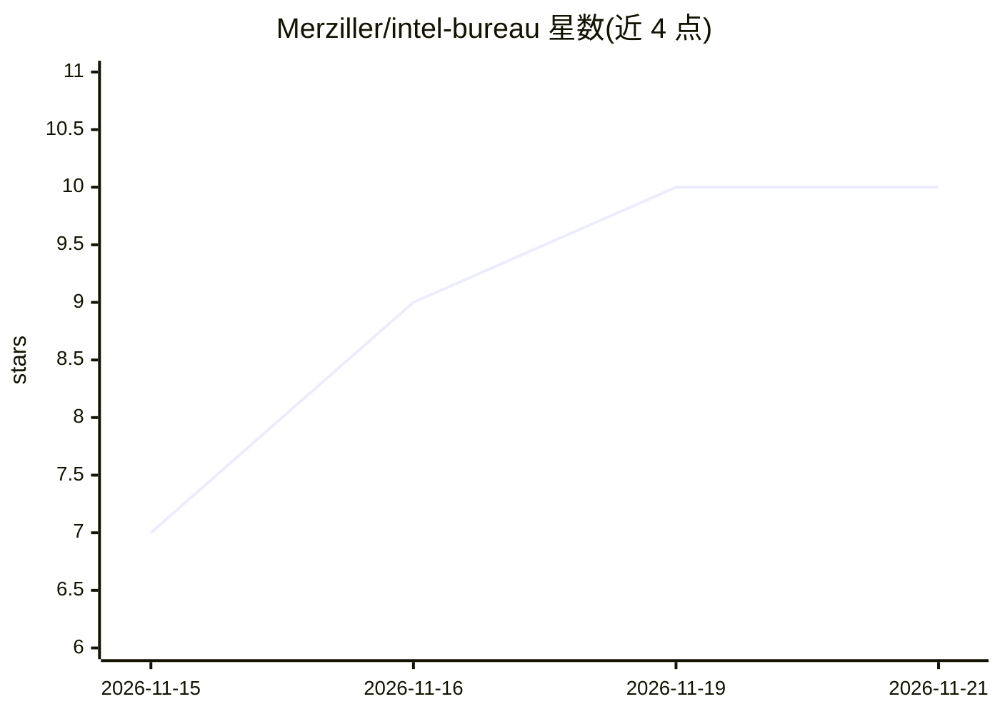

# Merziller/intel-bureau

⭐ 10 · Python · MIT · 推送 2026-11-14 · [GitHub](https://github.com/Merziller/intel-bureau) · 个人维护 · 中文 README

**只读采集群聊消息、自动生成每日情报报告的个人工作台**

按设定时间从白名单微信群、QQ 群、飞书群只读采集消息，经 12 阶段流水线提炼生成「每日风向标」报告，推送到飞书/微信/QQ/邮箱，并在本地 Web 大屏实时展示。大模型只写文字，计数由代码生成，每条情报附原文摘录；默认离线规则提取，同意后才调用云端模型；服务只监听 127.0.0.1，不上云。接入工具不附带，由脚本从官方发布页下载并校验。

## 筛选速览

| 维度 | 判定 | 备注 |
|---|---|---|
| AI 角色 | `ai-native` | 本体是模型或模型工具 |
| 许可风险 | `permissive` | MIT |
| 部署形态 | `desktop` | 安装包/桌面程序 |
| 模型依赖 | local-ok | 支持本地模型 |
| 硬件要求 | — | 无带数字的原话,不猜 |
| 安装摩擦 | `low` | 无编译、无系统依赖或容器化 |
| 成熟度 | — | 结构信号不足 |

## 能力要点

- 只读采集微信/QQ/飞书群消息，仅处理白名单群
- 报告支持多 LLM 提供方：OpenAI 兼容接口、Anthropic、本机 Claude CLI、离线规则
- 关键词与过去 7 天比较（z 值）识别上升信号，话题区分新出现/持续发酵/重复
- 按话题指纹写入知识库，同话题再出现时合并更新

## 适用场景

- 每天定时汇总我关注的群聊风向，推送到飞书和邮箱
- 不开云端模型，纯本地规则摘录群聊要点
- 把导出的聊天记录拖进导入区做离线分析
- 跨群话题合并生成专题文章并沉淀到知识库

## 场景标签

`数据分析` `知识库管理` `AI 写作` · 领域:效率与自动化

## 证据(README 行号)

> L8: 每天按你设定的时间，从你加入白名单的**微信群、QQ 群、飞书群**采集消息，提炼出有价值的情报，生成「每日风向标」，推送到飞书 / 微信 / QQ / 邮箱（可多选），并在本地的「AI Agent 作战大屏」里实时展示整个过程。
> L46: |`bureau/llm/`|大模型提供方：`claude_code`、`openai_compat`、`anthropic`、`offline`、`auto`|
> L164: |`openai_compat`|预设 DeepSeek、通义千问（DashScope 兼容模式）、Kimi、智谱、硅基流动、OpenRouter、本地 Ollama|

## 星数曲线

2026-11-15 7 → 2026-11-21 10（+3）

---
*卡片 v1 · prompt 1.4 · 生成 2026-11-20 · 置信度 mid · 依据 README sha `40d56106be1d` · [字段定义](../../DATASET.md)*
