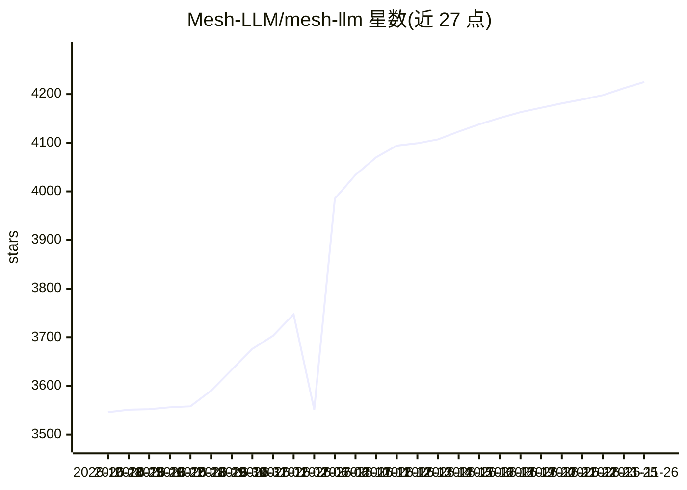

# Mesh-LLM/mesh-llm

⭐ 4,225 · Rust · Apache-2.0 · 推送 2026-11-25 · [GitHub](https://github.com/Mesh-LLM/mesh-llm) · [官网](http://meshllm.cloud/) · 组织维护

**跨机器聚合 GPU 算力，对外暴露 OpenAI 兼容 API**

用 Rust 编写的分布式 LLM 服务程序，将多台机器的 GPU 与内存组成 mesh，统一暴露为 OpenAI 兼容 API（默认端口 9337），并附 Web 控制台（端口 3131）。内含 Skippy 运行时负责模型管理与原生推理（含修补版 llama.cpp），Mesh 层提供节点发现、QUIC 加密传输、路由与插件机制；单机可跑的模型本地执行，过大模型可用 Skippy stage splits 分层跨节点执行。发布版本预编译 CPU/CUDA/ROCm/Vulkan/Metal 等多后端二进制，亦可从源码构建。

## 筛选速览

| 维度 | 判定 | 备注 |
|---|---|---|
| AI 角色 | `ai-ecosystem` | LLM/agent 周边工具 |
| 许可风险 | `permissive` | Apache-2.0 |
| 部署形态 | `desktop` | 安装包/桌面程序 |
| 模型依赖 | local-ok | 支持本地模型 |
| 硬件要求 | — | 无带数字的原话,不猜 |
| 安装摩擦 | `medium` | 含编译或系统依赖之一 |
| 成熟度 | — | 结构信号不足 |

## 能力要点

- 跨节点池化 GPU/内存，暴露单一 OpenAI 兼容 /v1 API
- QUIC 端到端加密的节点间传输，Nostr 公共发现与邀请 token 加入
- Skippy stage splits 支持单机装不下的大模型分层执行
- 支持 GGUF 的多模型家族（Qwen、Llama、DeepSeek、GLM 等）及多模态分片

## 适用场景

- 把家里多台机器的闲置 GPU 拼成一个推理节点池
- 给 Claude Code/Goose/OpenCode 等 agent 提供本地 OpenAI 兼容端点
- 公开或私有发布 mesh，通过付费插件对外提供推理服务

## 场景标签

`推理引擎` · 领域:训练与推理

## 证据(README 行号)

> L5: Mesh LLM pools GPUs and memory across machines and exposes the result as one
> L6: OpenAI-compatible API at `http://localhost:9337/v1`. Start one node, add more
> L122: - **Mesh routing.** Every node exposes the same `/v1` API. Requests are routed

## 星数曲线

2026-10-24 3,546 → 2026-11-26 4,225（+679）

---
*卡片 v1 · prompt 1.4 · 生成 2026-11-24 · 置信度 high · 依据 README sha `9224b5554b53` · [字段定义](../../DATASET.md)*
