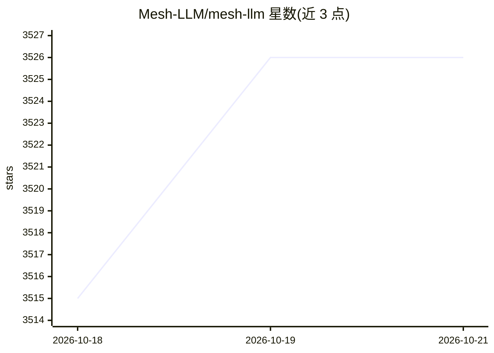

# Mesh-LLM/mesh-llm

⭐ 3,526 · Rust · Apache-2.0 · 推送 2026-10-19 · [GitHub](https://github.com/Mesh-LLM/mesh-llm) · [官网](http://meshllm.cloud/) · 组织维护

**跨机汇聚 GPU/内存的分布式 LLM 推理网格，暴露 OpenAI 兼容 API**

Mesh LLM 将多台机器的 GPU 与内存组成网格，经 Skippy（补丁版 llama.cpp 运行时）执行原生推理与分层切分（stage splits），对外在 9337 端口提供一个 OpenAI 兼容 API 与网页控制台。节点间用 QUIC 端到端加密传输，公共网格经 Nostr 发现、私有网格用邀请令牌；单机放不下的模型按层分包到多个节点。支持约 72 个 P0/P1 模型家族（Qwen/Llama/GLM/DeepSeek 等），提供安装脚本、Homebrew 公式、各平台 CUDA/ROCm/Vulkan 构建包，也可用 just 从源码构建。MoA 网关（model:mesh）为实验性功能。

## 筛选速览

| 维度 | 判定 | 备注 |
|---|---|---|
| AI 角色 | `ai-ecosystem` | LLM/agent 周边工具 |
| 许可风险 | `permissive` | Apache-2.0 |
| 部署形态 | `desktop` | 安装包/桌面程序 |
| 模型依赖 | local-ok | 支持本地模型 |
| 硬件要求 | — | 无带数字的原话,不猜 |
| 安装摩擦 | `medium` | 含编译或系统依赖之一 |
| 成熟度 | `idea` | |

## 能力要点

- 多节点 GPU/内存池化，单机放不下的模型按层切分到多节点执行
- 对外统一 OpenAI 兼容 API（/v1），按 model 字段路由到可服务节点
- QUIC 端到端加密的节点间传输，公共/私有两种网格加入方式
- 覆盖 72 个 P0/P1 模型家族，多平台 CPU/CUDA/ROCm/Vulkan 发行包

## 适用场景

- 把手头多台机器的算力拼起来跑超出单机容量的模型
- 在局域网或朋友间搭一个私有的 OpenAI 兼容推理服务
- 用 model:mesh 把一个提问并发发给网格内所有模型再仲裁

## 场景标签

`推理引擎` · 领域:训练与推理

## 证据(README 行号)

> L5: Mesh LLM pools GPUs and memory across machines and exposes the result as one
> L6: OpenAI-compatible API at `http://localhost:9337/v1`. Start one node, add more
> L13: execution and OpenAI serving. Mesh adds peer discovery,
> L14: transport, routing, plugins and the console around the same Skippy serving

## 星数曲线

2026-10-18 3,515 → 2026-10-21 3,526（+11）

---
*卡片 v1 · prompt 1.4 · 生成 2026-10-20 · 置信度 high · 依据 README sha `7d5beddd3638` · [字段定义](../../DATASET.md)*
