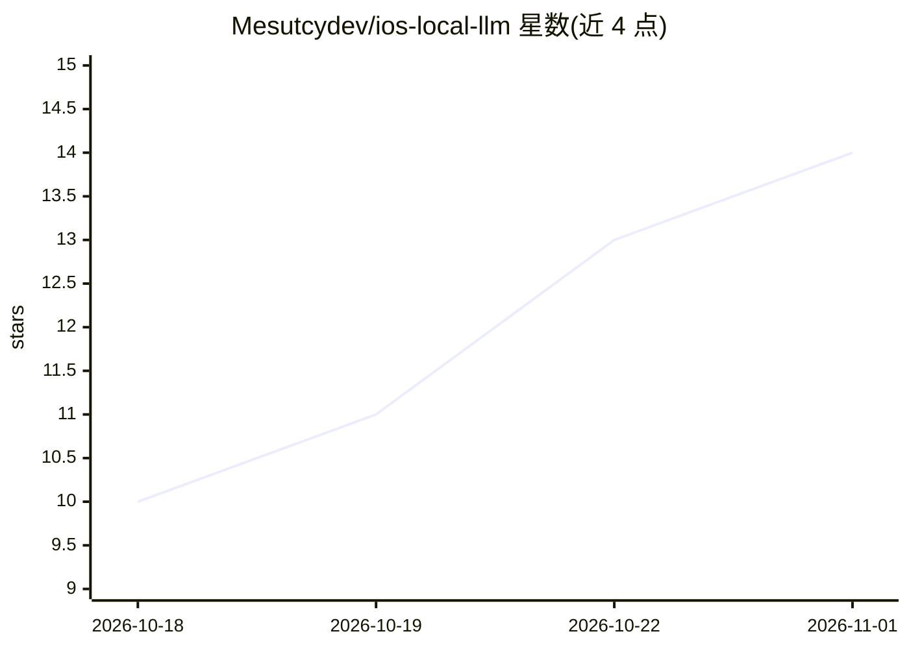

# Mesutcydev/ios-local-llm

⭐ 14 · Swift · MIT · 推送 2026-10-01 · [GitHub](https://github.com/Mesutcydev/ios-local-llm) · [官网](https://mesutcydev.github.io/ios-local-llm/) · 个人维护

**iPhone/Apple silicon 本地运行 LLM 的 SwiftUI 离线工作台**

SwiftUI 编写的本地优先 AI 工作台，在 iPhone 与 Apple silicon Mac（Catalyst）上用 MLX、llama.cpp、whisper.cpp、Core ML 运行语言、视觉、语音与图像生成模型，支持 RAG、Hugging Face 模型发现下载，并提供可选启用的 OpenAI/Anthropic/Ollama 兼容本地 API 与 iPhone-Mac 配对工具协议。无账号、无遥测、默认无云端推理。仓库仅源码分发（IPA 侧载已停止，App Store 上架未发布），需 XcodeGen、CocoaPods、CMake 自行构建原生推理框架；不随仓库分发任何模型权重。

## 筛选速览

| 维度 | 判定 | 备注 |
|---|---|---|
| AI 角色 | `ai-native` | 本体是模型或模型工具 |
| 许可风险 | `permissive` | MIT |
| 部署形态 | `None` |  |
| 模型依赖 | local-ok | 支持本地模型 |
| 硬件要求 | — | 无带数字的原话,不猜 |
| 安装摩擦 | `low` | 无编译、无系统依赖或容器化 |
| 成熟度 | `idea` | |

## 能力要点

- 设备端聊天、视觉、语音转录与语音合成（MLX/whisper.cpp）
- 带鉴权的 OpenAI/Anthropic/Ollama 兼容本地 API 与 Mac 桥接
- Hugging Face 模型发现与按需下载
- 组件按 Extractable/Adaptable/Integrated 分级供复用

## 适用场景

- 在 iPhone 上离线运行开源 LLM 进行对话、视觉与语音交互
- 让局域网内的开发工具或 agent 调用本地兼容 API
- 复用其中组件搭建自己的 iOS 本地 LLM 应用

## 场景标签

`聊天机器人` `RAG` `语音识别` `语音合成` · 领域:对话与助手

## 证据(README 行号)

> L3: **Run open-source LLMs on iPhone offline** — chat, vision, voice, RAG, and an
> L61: - On-device chat and code assistance with MLX models
> L63: - Local voice activity detection, transcription, and speech synthesis

## 星数曲线

2026-10-18 10 → 2026-11-01 14（+4）

---
*卡片 v1 · prompt 1.4 · 生成 2026-10-31 · 置信度 high · 依据 README sha `eeae9766f458` · [字段定义](../../DATASET.md)*
