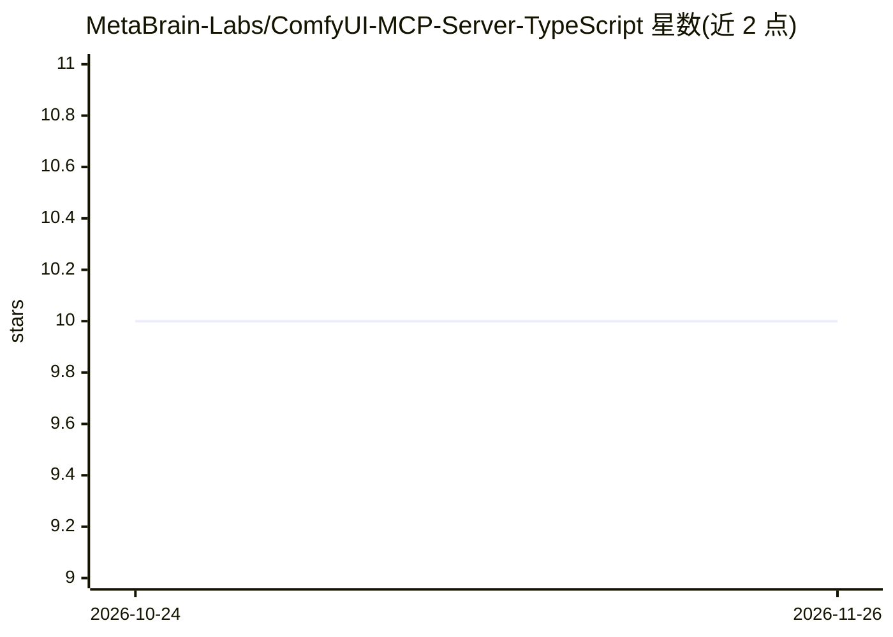

# MetaBrain-Labs/ComfyUI-MCP-Server-TypeScript

⭐ 10 · TypeScript · MIT · 推送 2026-03-20 · [GitHub](https://github.com/MetaBrain-Labs/ComfyUI-MCP-Server-TypeScript) · [官网](https://metabrain.site/) · 组织维护 · 中文 README

**将 ComfyUI 工作流转为 MCP 工具供 AI 代理调用**

基于 MCP 协议的服务器，将 ComfyUI 用户自定义工作流转换为参数可配置的工具，供 Claude Desktop、Trae、Dify 等 AI 代理通过自然语言调用图像/视频生成。工作流经特定标记（工具名与暴露参数）后自动校验挂载，支持 STDIO 与 Streamable HTTP 传输、任务队列与资产管理、会话管理。依赖 Node.js 18+ 与 ComfyUI 0.9.1+，当前版本未实现强鉴权，建议不暴露公网运行。

## 筛选速览

| 维度 | 判定 | 备注 |
|---|---|---|
| AI 角色 | `ai-ecosystem` | LLM/agent 周边工具 |
| 许可风险 | `permissive` | MIT |
| 部署形态 | `library` | 以包/库形式分发 |
| 模型依赖 | — | README 未给出锁定关系 |
| 硬件要求 | — | 无带数字的原话,不猜 |
| 安装摩擦 | `low` | 无编译、无系统依赖或容器化 |
| 成熟度 | — | 结构信号不足 |

## 能力要点

- 工作流即工具：节点图抽象为 Agent 可用工具，限定 AI 仅在暴露参数范围内操作
- 支持 STDIO 与 Streamable HTTP 两种传输方式，中英文双语
- 提供 12 个内置工具覆盖目录检索、参数挂载、任务提交/取消、资产保存与系统监控
- 自动过滤未标记工作流与参数，防止模型伪造工作流名与键名

## 适用场景

- 让 Claude Desktop 等客户端通过自然语言驱动 ComfyUI 生图
- 将团队已调好的 ComfyUI 工作流挂载为 AI 可调用的参数化工具
- 网络化部署中通过 HTTP 方式供多客户端调用生成服务

## 场景标签

`图像生成` `视频生成` · 领域:内容生成

## 证据(README 行号)

> L17: **ComfyUI-MCP-Server 是一个基于 MCP（Model Context Protocol / 模型上下文协议）的服务器实现，将 ComfyUI 中用户定义的工作流转化为参数可配置的 MCP 工具，供 AI 代理（
> L40: - 🔌 **工作流即工具**：将 ComfyUI 的节点图抽象为可供Agent使用的工具。
> L47: - 🧩 **标准 MCP 适配**：全面支持 STDIO 与 Streamable HTTP 通信协议。

## 星数曲线

2026-10-24 10 → 2026-11-26 10（+0）

---
*卡片 v1 · prompt 1.4 · 生成 2026-11-20 · 置信度 high · 依据 README sha `e1fd39be774a` · [字段定义](../../DATASET.md)*
